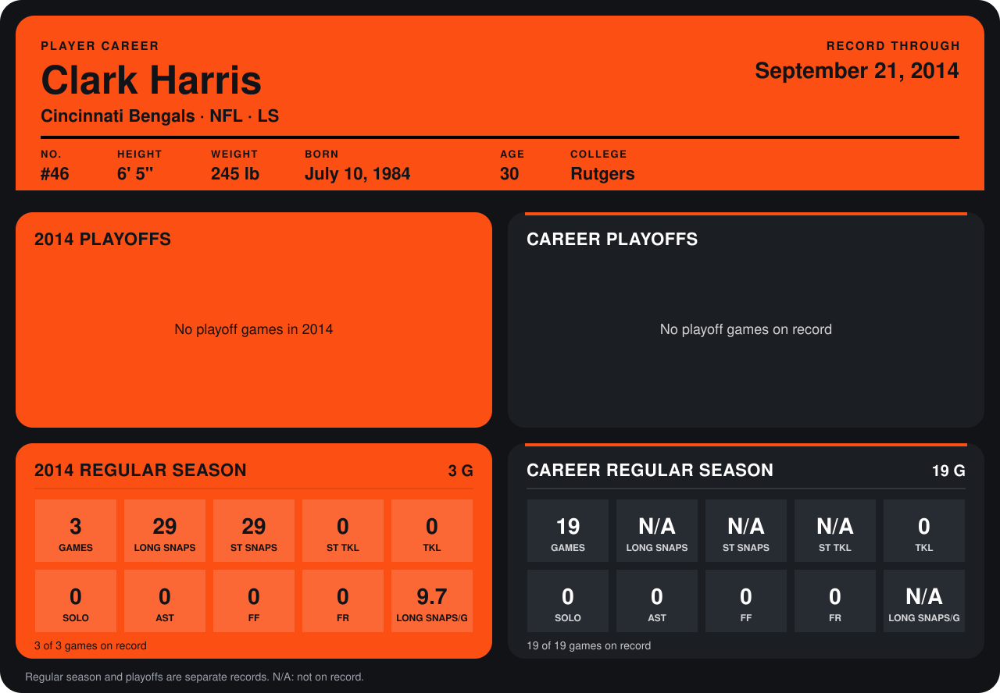

# Clark Harris

## Career stats

### Regular season

| Season | Team | Age | # | G | LONG SNAPS | ST SNAPS | ST TKL | TKL | SOLO | AST | FF | FR | LONG SNAPS/G |
|---|---|---:|---:|---:|---:|---:|---:|---:|---:|---:|---:|---:|---:|
| 2013 | Cincinnati Bengals | 29 | 46 | 16 | N/A | N/A | N/A | 0 | 0 | 0 | 0 | 0 | N/A |
| 2014 | Cincinnati Bengals | 30 | 46 | 3 | 29 | 29 | 0 | 0 | 0 | 0 | 0 | 0 | 9.7 |
| **Career** |  |  |  | 19 | N/A | N/A | N/A | 0 | 0 | 0 | 0 | 0 | N/A |

### Playoffs

No playoff games on record.

## Awards

None on record.

Age is his age on the league's opening game of each season; # is the number listed for him that season with that team (2014: the card's rule; 2013: the 2013 season roster), N/A where no listing applies.

Records through September 21, 2014. Identity: listed 2014 roster data, Weeks 1-4; number: 2014 Week 1 roster. [All Cincinnati Bengals players](README.md).
