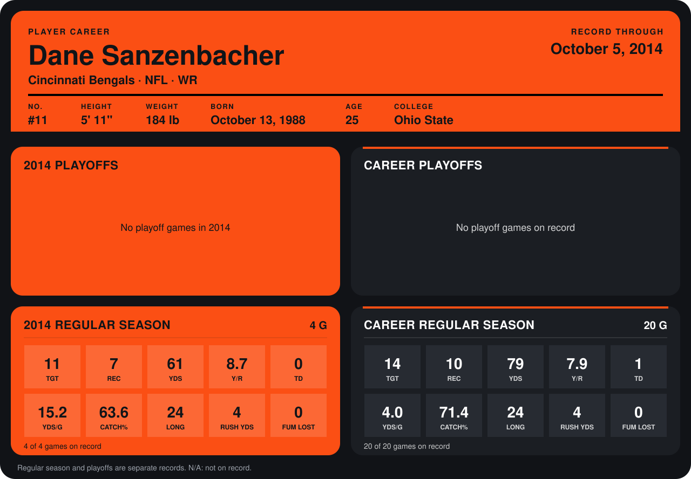

# Dane Sanzenbacher

## Career stats

### Regular season

| Season | Team | Age | # | G | TGT | REC | YDS | Y/R | TD | YDS/G | CATCH% | LONG | RUSH YDS | FUM LOST |
|---|---|---:|---:|---:|---:|---:|---:|---:|---:|---:|---:|---:|---:|---:|
| 2013 | Cincinnati Bengals | 24 | 11 | 16 | 3 | 3 | 18 | 6.0 | 1 | 1.1 | 100.0 | 8 | 0 | 0 |
| 2014 | Cincinnati Bengals | 25 | 11 | 4 | 11 | 7 | 61 | 8.7 | 0 | 15.2 | 63.6 | 24 | 4 | 0 |
| **Career** |  |  |  | 20 | 14 | 10 | 79 | 7.9 | 1 | 4.0 | 71.4 | 24 | 4 | 0 |

### Playoffs

No playoff games on record.

## Awards

None on record.

Age is his age on the league's opening game of each season; # is the number listed for him that season with that team (2014: the card's rule; 2013: the 2013 season roster), N/A where no listing applies.

Records through October 5, 2014. Identity: listed 2014 roster data, Weeks 1-4; number: 2014 Week 1 roster. [All Cincinnati Bengals players](README.md).
