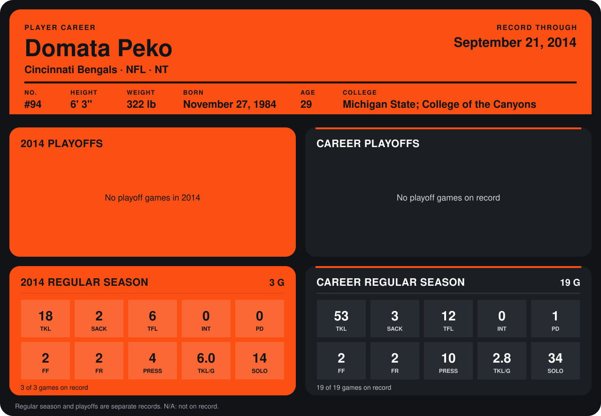

# Domata Peko

## Career stats

### Regular season

| Season | Club | G | TKL | SACK | TFL | INT | PD | FF | FR | PRESS | TKL/G | SOLO |
|---|---|---:|---:|---:|---:|---:|---:|---:|---:|---:|---:|---:|
| 2013 | Cincinnati Bengals | 16 | 35 | 1 | 6 | 0 | 1 | 0 | 0 | 6 | 2.2 | 20 |
| 2014 | Cincinnati Bengals | 3 | 18 | 2 | 6 | 0 | 0 | 2 | 2 | 4 | 6.0 | 14 |
| **Career** |  | 19 | 53 | 3 | 12 | 0 | 1 | 2 | 2 | 10 | 2.8 | 34 |

### Playoffs

No playoff games on record.

## Awards

None on record.

Records through September 21, 2014. Identity: listed 2014 roster data, Weeks 1-4; number: 2014 Week 1 roster. [All Cincinnati Bengals players](README.md).
