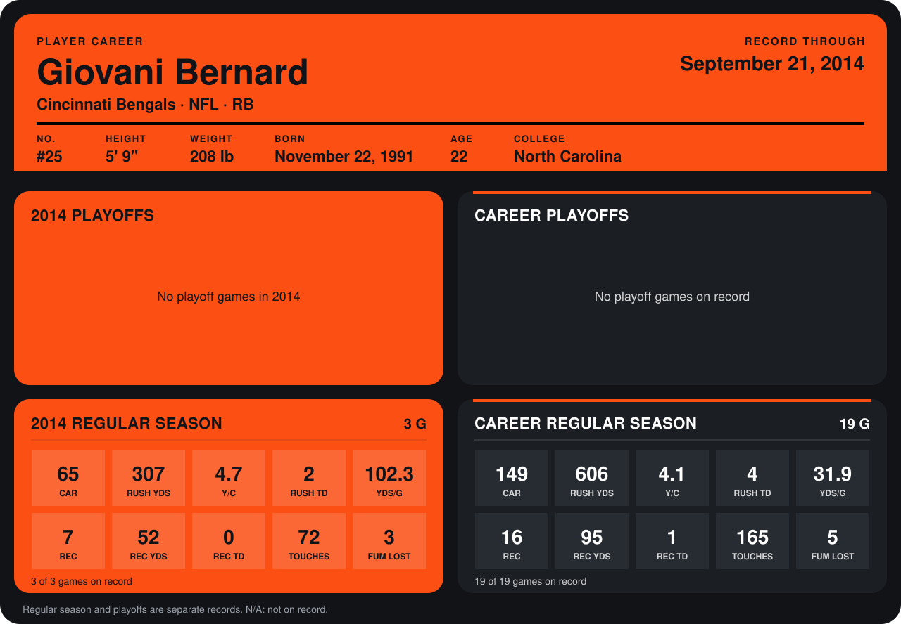

# Giovani Bernard

## Career stats

### Regular season

| Season | Club | G | CAR | RUSH YDS | Y/C | RUSH TD | YDS/G | REC | REC YDS | REC TD | TOUCHES | FUM LOST |
|---|---|---:|---:|---:|---:|---:|---:|---:|---:|---:|---:|---:|
| 2013 | Cincinnati Bengals | 16 | 84 | 299 | 3.6 | 2 | 18.7 | 9 | 43 | 1 | 93 | 2 |
| 2014 | Cincinnati Bengals | 4 | 82 | 335 | 4.1 | 2 | 83.8 | 9 | 60 | 0 | 91 | 3 |
| **Career** |  | 20 | 166 | 634 | 3.8 | 4 | 31.7 | 18 | 103 | 1 | 184 | 5 |

### Playoffs

No playoff games on record.

## Awards

None on record.

Records through October 5, 2014. Identity: listed 2014 roster data, Weeks 1-4; number: 2014 Week 1 roster. [All Cincinnati Bengals players](README.md).
