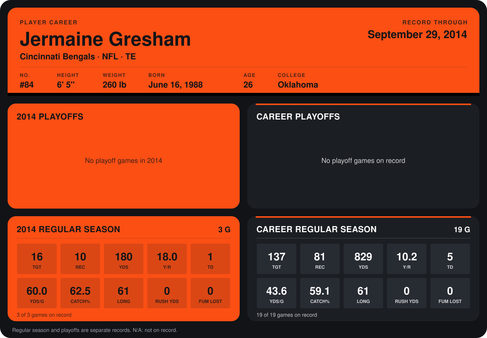

# Jermaine Gresham

## Career stats

### Regular season

| Season | Club | G | TGT | REC | YDS | Y/R | TD | YDS/G | CATCH% | LONG | RUSH YDS | FUM LOST |
|---|---|---:|---:|---:|---:|---:|---:|---:|---:|---:|---:|---:|
| 2013 | Cincinnati Bengals | 16 | 121 | 71 | 649 | 9.1 | 4 | 40.6 | 58.7 | 33 | 0 | 0 |
| 2014 | Cincinnati Bengals | 4 | 21 | 13 | 226 | 17.4 | 1 | 56.5 | 61.9 | 61 | 0 | 0 |
| **Career** |  | 20 | 142 | 84 | 875 | 10.4 | 5 | 43.8 | 59.2 | 61 | 0 | 0 |

### Playoffs

No playoff games on record.

## Awards

None on record.

Records through October 5, 2014. Identity: listed 2014 roster data, Weeks 1-4; number: 2014 Week 1 roster. [All Cincinnati Bengals players](README.md).
