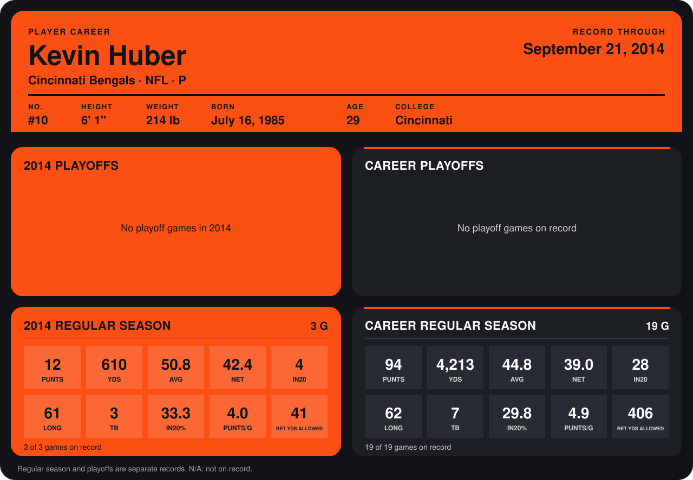

# Kevin Huber

## Career stats

### Regular season

| Season | Club | G | PUNTS | YDS | AVG | NET | IN20 | LONG | TB | IN20% | PUNTS/G | RET YDS ALLOWED |
|---|---|---:|---:|---:|---:|---:|---:|---:|---:|---:|---:|---:|
| 2013 | Cincinnati Bengals | 16 | 82 | 3,603 | 43.9 | 38.5 | 24 | 62 | 4 | 29.3 | 5.1 | 365 |
| 2014 | Cincinnati Bengals | 4 | 17 | 829 | 48.8 | 39.3 | 6 | 61 | 5 | 35.3 | 4.2 | 61 |
| **Career** |  | 20 | 99 | 4,432 | 44.8 | 38.6 | 30 | 62 | 9 | 30.3 | 5.0 | 426 |

### Playoffs

No playoff games on record.

## Awards

None on record.

Records through October 5, 2014. Identity: listed 2014 roster data, Weeks 1-4; number: 2014 Week 1 roster. [All Cincinnati Bengals players](README.md).
