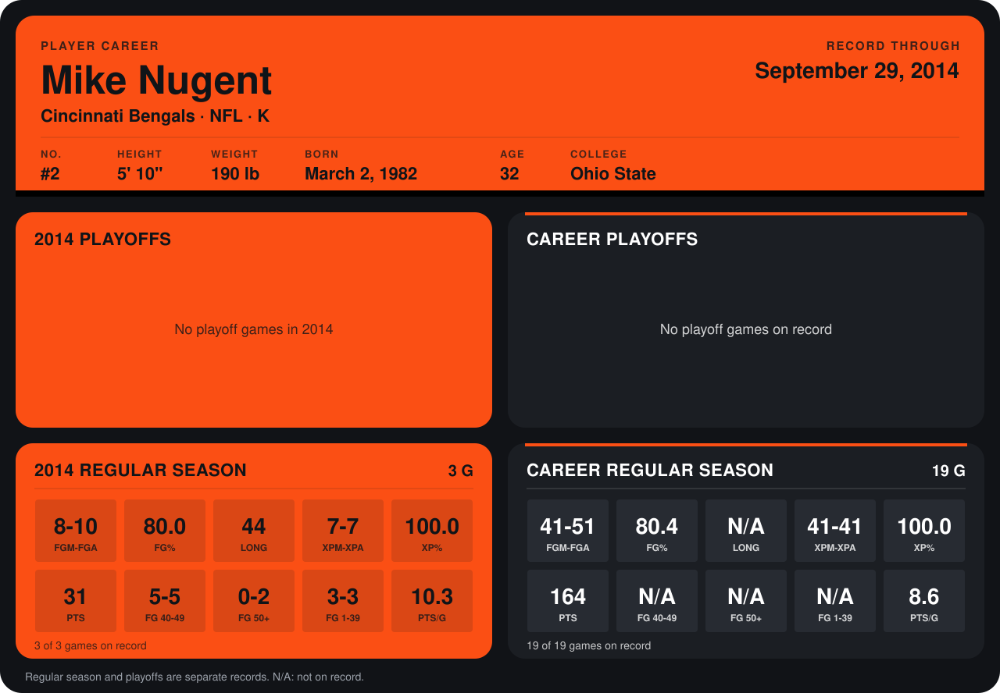

# Mike Nugent

## Career stats

### Regular season

| Season | Club | G | FGM-FGA | FG% | LONG | XPM-XPA | XP% | PTS | FG 40-49 | FG 50+ | FG 1-39 | PTS/G |
|---|---|---:|---:|---:|---:|---:|---:|---:|---:|---:|---:|---:|
| 2013 | Cincinnati Bengals | 16 | 33-41 | 80.5 | N/A | 34-34 | 100.0 | 133 | N/A | N/A | N/A | 8.3 |
| 2014 | Cincinnati Bengals | 3 | 8-10 | 80.0 | 44 | 7-7 | 100.0 | 31 | 5-5 | 0-2 | 3-3 | 10.3 |
| **Career** |  | 19 | 41-51 | 80.4 | N/A | 41-41 | 100.0 | 164 | N/A | N/A | N/A | 8.6 |

### Playoffs

No playoff games on record.

## Awards

- AFC Special Teams Player of the Week (2013, Week 2)

Records through September 21, 2014. Identity: listed 2014 roster data, Weeks 1-4; number: 2014 Week 1 roster. [All Cincinnati Bengals players](README.md).
