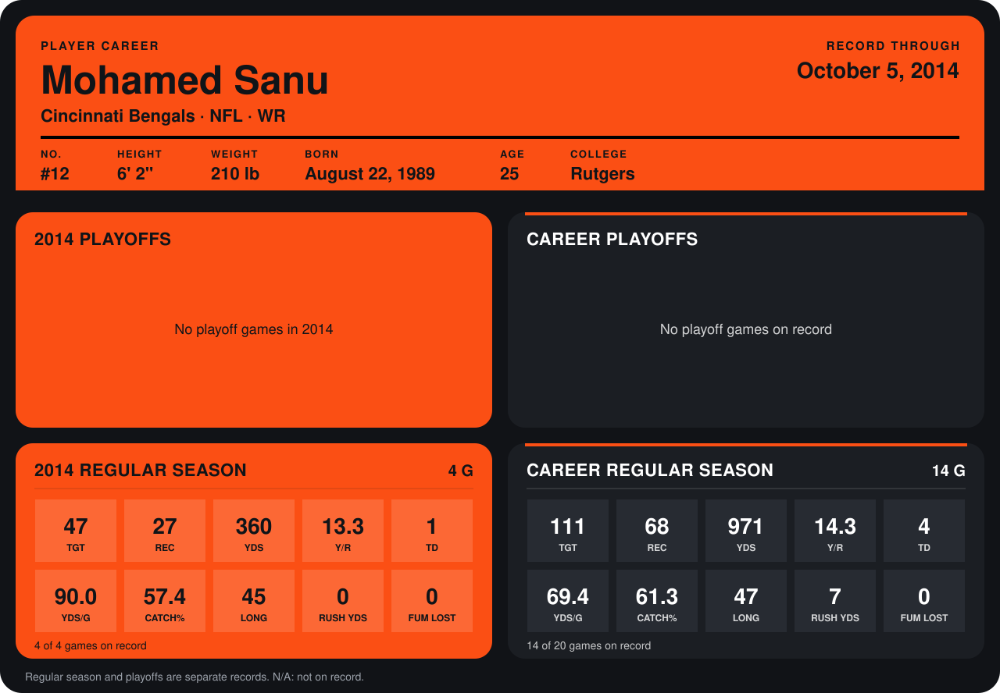

# Mohamed Sanu

## Career stats

### Regular season

| Season | Club | G | TGT | REC | YDS | Y/R | TD | YDS/G | CATCH% | LONG | RUSH YDS | FUM LOST |
|---|---|---:|---:|---:|---:|---:|---:|---:|---:|---:|---:|---:|
| 2013 | Cincinnati Bengals | 10 | 64 | 41 | 611 | 14.9 | 3 | 61.1 | 64.1 | 47 | 7 | 0 |
| 2014 | Cincinnati Bengals | 3 | 33 | 19 | 265 | 13.9 | 0 | 88.3 | 57.6 | 45 | 0 | 0 |
| **Career** |  | 13 | 97 | 60 | 876 | 14.6 | 3 | 67.4 | 61.9 | 47 | 7 | 0 |

### Playoffs

No playoff games on record.

## Awards

None on record.

Records through September 21, 2014. Identity: listed 2014 roster data, Weeks 1-4; number: 2014 Week 1 roster. [All Cincinnati Bengals players](README.md).
