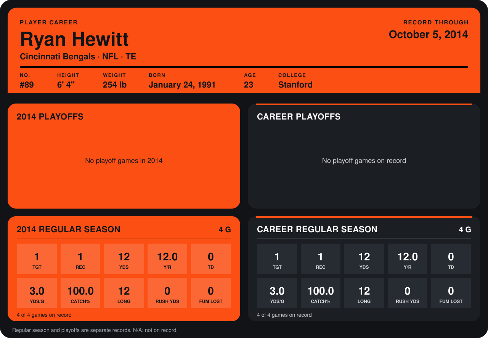

# Ryan Hewitt

## Career stats

### Regular season

| Season | Club | G | TGT | REC | YDS | Y/R | TD | YDS/G | CATCH% | LONG | RUSH YDS | FUM LOST |
|---|---|---:|---:|---:|---:|---:|---:|---:|---:|---:|---:|---:|
| 2014 | Cincinnati Bengals | 4 | 1 | 1 | 12 | 12.0 | 0 | 3.0 | 100.0 | 12 | 0 | 0 |
| **Career** |  | 4 | 1 | 1 | 12 | 12.0 | 0 | 3.0 | 100.0 | 12 | 0 | 0 |

### Playoffs

No playoff games on record.

## Awards

None on record.

Records through October 5, 2014. Identity: listed 2014 roster data, Weeks 1-4; number: 2014 Week 1 roster. [All Cincinnati Bengals players](README.md).
