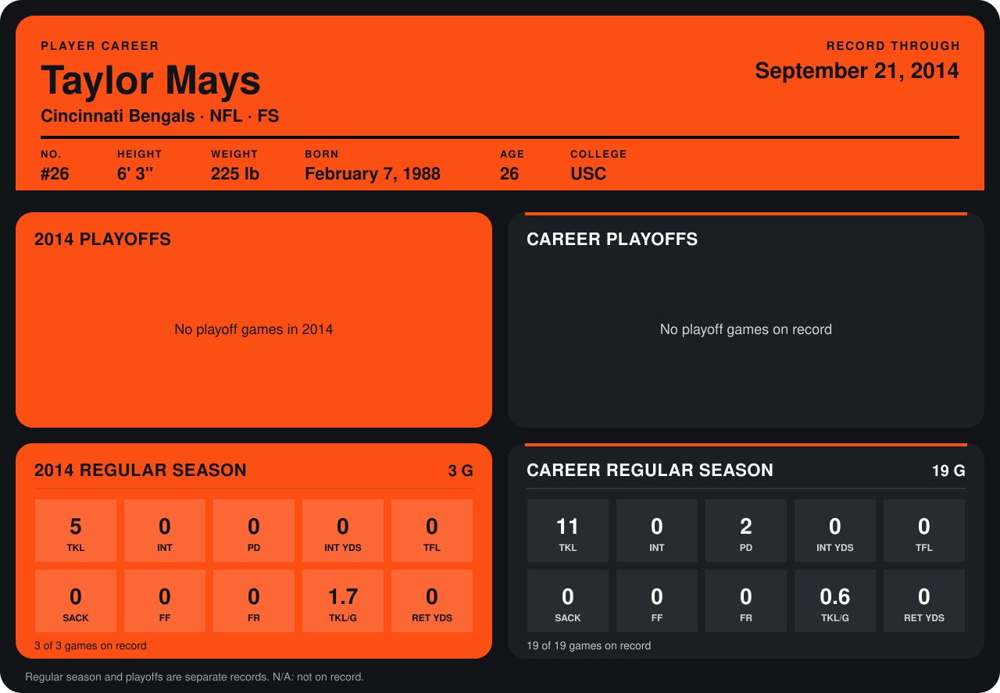

# Taylor Mays

## Career stats

### Regular season

| Season | Club | G | TKL | INT | PD | INT YDS | TFL | SACK | FF | FR | TKL/G | RET YDS |
|---|---|---:|---:|---:|---:|---:|---:|---:|---:|---:|---:|---:|
| 2013 | Cincinnati Bengals | 16 | 6 | 0 | 2 | 0 | 0 | 0 | 0 | 0 | 0.4 | 0 |
| 2014 | Cincinnati Bengals | 3 | 5 | 0 | 0 | 0 | 0 | 0 | 0 | 0 | 1.7 | 0 |
| **Career** |  | 19 | 11 | 0 | 2 | 0 | 0 | 0 | 0 | 0 | 0.6 | 0 |

### Playoffs

No playoff games on record.

## Awards

None on record.

Records through September 21, 2014. Identity: listed 2014 roster data, Weeks 1-4; number: 2014 Week 1 roster. [All Cincinnati Bengals players](README.md).
