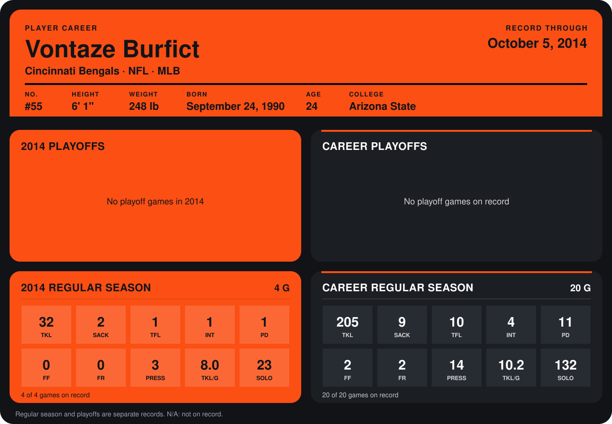

# Vontaze Burfict

## Career stats

### Regular season

| Season | Team | Age | # | G | TKL | SACK | TFL | INT | PD | FF | FR | PRESS | TKL/G | SOLO |
|---|---|---:|---:|---:|---:|---:|---:|---:|---:|---:|---:|---:|---:|---:|
| 2013 | Cincinnati Bengals | 22 | 55 | 16 | 173 | 7 | 9 | 3 | 10 | 2 | 2 | 11 | 10.8 | 109 |
| 2014 | Cincinnati Bengals | 23 | 55 | 4 | 32 | 2 | 1 | 1 | 1 | 0 | 0 | 3 | 8.0 | 23 |
| **Career** |  |  |  | 20 | 205 | 9 | 10 | 4 | 11 | 2 | 2 | 14 | 10.2 | 132 |

### Playoffs

No playoff games on record.

## Awards

- AFC Defensive Player of the Month (2013, December)
- AP First-Team All-Pro (2013, ILB)
- Pro Bowl selection (2013, ILB)

Age is his age on the league's opening game of each season; # is the number listed for him that season with that team (2014: the card's rule; 2013: the 2013 season roster), N/A where no listing applies.

Records through October 5, 2014. Identity: listed 2014 roster data, Weeks 1-4; number: 2014 Week 1 roster. [All Cincinnati Bengals players](README.md).
