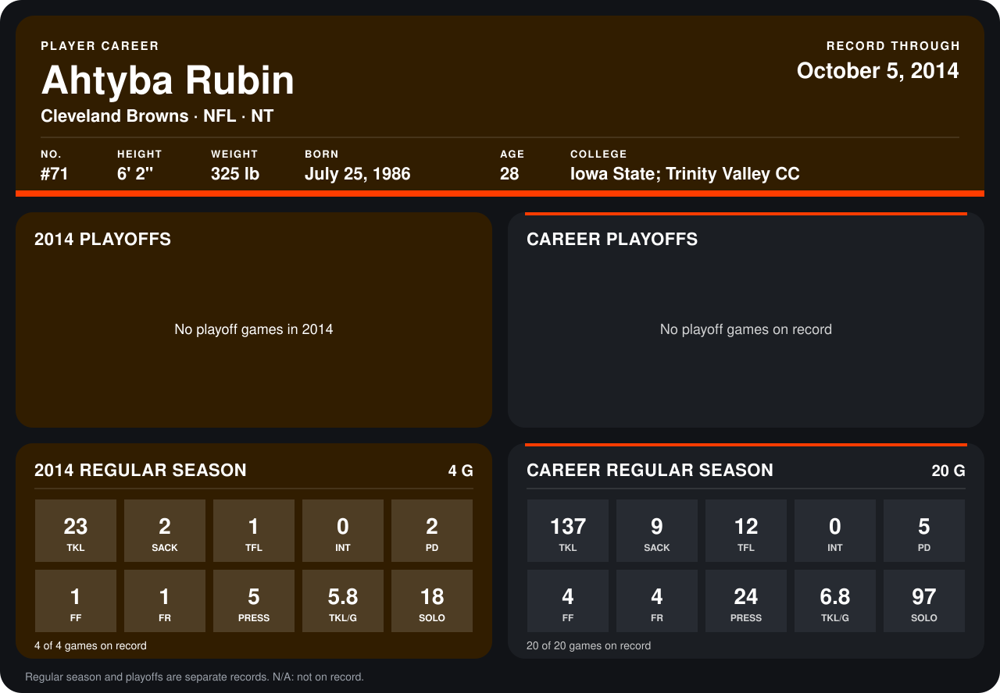

# Ahtyba Rubin

## Career stats

### Regular season

| Season | Team | Age | # | G | TKL | SACK | TFL | INT | PD | FF | FR | PRESS | TKL/G | SOLO |
|---|---|---:|---:|---:|---:|---:|---:|---:|---:|---:|---:|---:|---:|---:|
| 2013 | Cleveland Browns | 27 | 71 | 16 | 114 | 7 | 11 | 0 | 3 | 3 | 3 | 19 | 7.1 | 79 |
| 2014 | Cleveland Browns | 28 | 71 | 3 | 16 | 2 | 1 | 0 | 2 | 1 | 1 | 5 | 5.3 | 14 |
| **Career** |  |  |  | 19 | 130 | 9 | 12 | 0 | 5 | 4 | 4 | 24 | 6.8 | 93 |

### Playoffs

No playoff games on record.

## Awards

- AP First-Team All-Pro (2013, DT)
- Pro Bowl selection (2013, DT)

Age is his age on the league's opening game of each season; # is the number listed for him that season with that team (2014: the card's rule; 2013: the 2013 season roster), N/A where no listing applies.

Records through September 21, 2014. Identity: listed 2014 roster data, Weeks 1-4; number: 2014 Week 1 roster. [All Cleveland Browns players](README.md).
