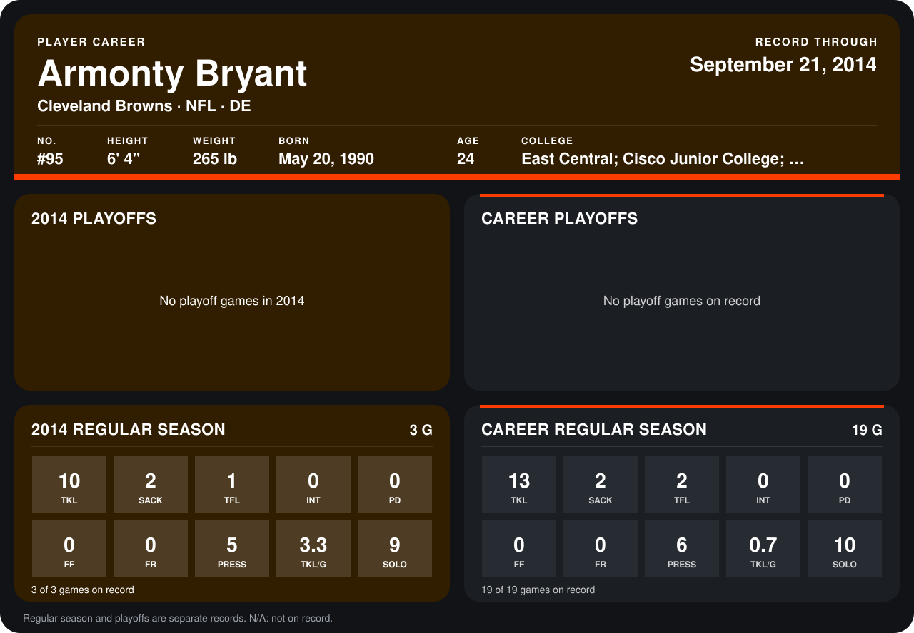

# Armonty Bryant

## Career stats

### Regular season

| Season | Team | Age | # | G | TKL | SACK | TFL | INT | PD | FF | FR | PRESS | TKL/G | SOLO |
|---|---|---:|---:|---:|---:|---:|---:|---:|---:|---:|---:|---:|---:|---:|
| 2013 | Cleveland Browns | 23 | 95 | 16 | 3 | 0 | 1 | 0 | 0 | 0 | 0 | 1 | 0.2 | 1 |
| 2014 | Cleveland Browns | 24 | 95 | 3 | 10 | 2 | 1 | 0 | 0 | 0 | 0 | 5 | 3.3 | 9 |
| **Career** |  |  |  | 19 | 13 | 2 | 2 | 0 | 0 | 0 | 0 | 6 | 0.7 | 10 |

### Playoffs

No playoff games on record.

## Awards

None on record.

Schools listed: East Central; Cisco Junior College; Abilene Christian.

Age is his age on the league's opening game of each season; # is the number listed for him that season with that team (2014: the card's rule; 2013: the 2013 season roster), N/A where no listing applies.

Records through September 21, 2014. Identity: listed 2014 roster data, Weeks 1-4; number: 2014 Week 1 roster. [All Cleveland Browns players](README.md).
