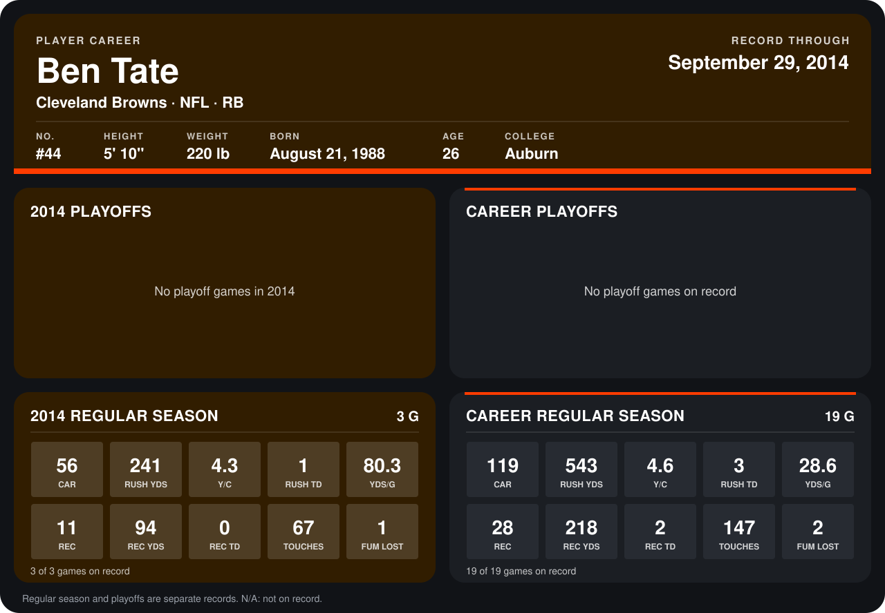

# Ben Tate

## Career stats

### Regular season

| Season | Club | G | CAR | RUSH YDS | Y/C | RUSH TD | YDS/G | REC | REC YDS | REC TD | TOUCHES | FUM LOST |
|---|---|---:|---:|---:|---:|---:|---:|---:|---:|---:|---:|---:|
| 2013 | Houston Texans | 16 | 63 | 302 | 4.8 | 2 | 18.9 | 17 | 124 | 2 | 80 | 1 |
| 2014 | Cleveland Browns | 3 | 56 | 241 | 4.3 | 1 | 80.3 | 11 | 94 | 0 | 67 | 1 |
| **Career** |  | 19 | 119 | 543 | 4.6 | 3 | 28.6 | 28 | 218 | 2 | 147 | 2 |

### Playoffs

No playoff games on record.

## Awards

None on record.

Records through September 21, 2014. Identity: listed 2014 roster data, Weeks 1-4; number: 2014 Week 1 roster. [All Cleveland Browns players](README.md).
