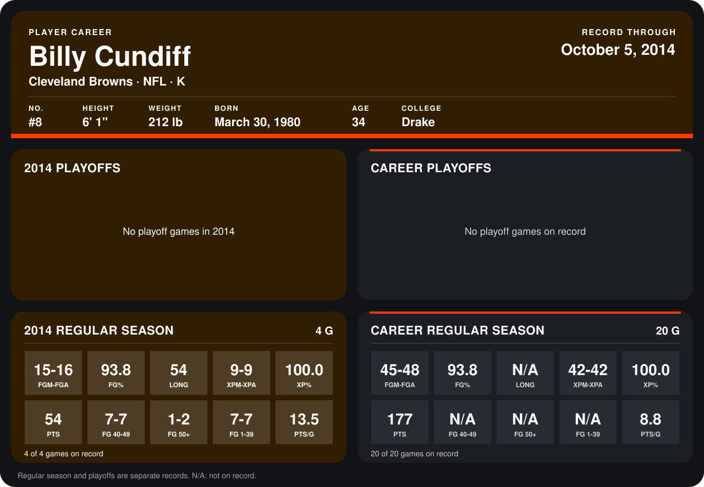

# Billy Cundiff

## Career stats

### Regular season

| Season | Club | G | FGM-FGA | FG% | LONG | XPM-XPA | XP% | PTS | FG 40-49 | FG 50+ | FG 1-39 | PTS/G |
|---|---|---:|---:|---:|---:|---:|---:|---:|---:|---:|---:|---:|
| 2013 | Cleveland Browns | 16 | 30-32 | 93.8 | N/A | 33-33 | 100.0 | 123 | N/A | N/A | N/A | 7.7 |
| 2014 | Cleveland Browns | 4 | 15-16 | 93.8 | 54 | 9-9 | 100.0 | 54 | 7-7 | 1-2 | 7-7 | 13.5 |
| **Career** |  | 20 | 45-48 | 93.8 | N/A | 42-42 | 100.0 | 177 | N/A | N/A | N/A | 8.8 |

### Playoffs

No playoff games on record.

## Awards

None on record.

Records through October 5, 2014. Identity: listed 2014 roster data, Weeks 1-4; number: 2014 Week 1 roster. [All Cleveland Browns players](README.md).
