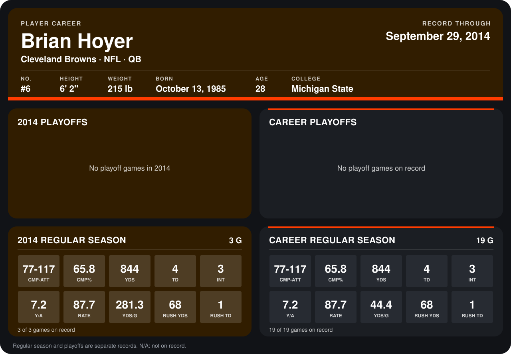

# Brian Hoyer

## Career stats

### Regular season

| Season | Club | G | CMP-ATT | CMP% | YDS | TD | INT | Y/A | RATE | YDS/G | RUSH YDS | RUSH TD |
|---|---|---:|---:|---:|---:|---:|---:|---:|---:|---:|---:|---:|
| 2013 | Cleveland Browns | 16 | 0-0 | N/A | 0 | 0 | 0 | N/A | N/A | 0.0 | 0 | 0 |
| 2014 | Cleveland Browns | 3 | 77-117 | 65.8 | 844 | 4 | 3 | 7.2 | 87.7 | 281.3 | 68 | 1 |
| **Career** |  | 19 | 77-117 | 65.8 | 844 | 4 | 3 | 7.2 | 87.7 | 44.4 | 68 | 1 |

### Playoffs

No playoff games on record.

## Awards

None on record.

Records through September 29, 2014. Identity: listed 2014 roster data, Weeks 1-4; number: 2014 Week 1 roster. [All Cleveland Browns players](README.md).
