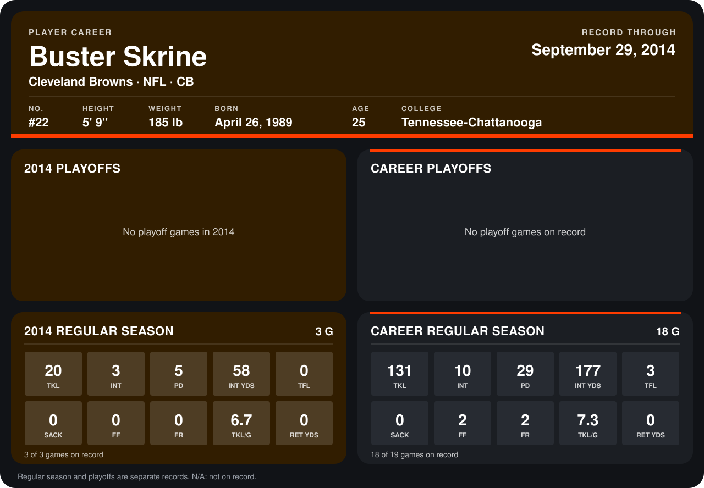

# Buster Skrine

## Career stats

### Regular season

| Season | Team | Age | # | G | TKL | INT | PD | INT YDS | TFL | SACK | FF | FR | TKL/G | RET YDS |
|---|---|---:|---:|---:|---:|---:|---:|---:|---:|---:|---:|---:|---:|---:|
| 2013 | Cleveland Browns | 24 | 22 | 15 | 111 | 7 | 24 | 119 | 3 | 0 | 2 | 2 | 7.4 | 0 |
| 2014 | Cleveland Browns | 25 | 22 | 4 | 26 | 3 | 5 | 58 | 0 | 0 | 0 | 0 | 6.5 | 0 |
| **Career** |  |  |  | 19 | 137 | 10 | 29 | 177 | 3 | 0 | 2 | 2 | 7.2 | 0 |

### Playoffs

No playoff games on record.

## Awards

- AFC Defensive Player of the Week (2013, Week 1)
- AFC Defensive Player of the Week (2013, Week 2)
- AFC Defensive Player of the Week (2013, Week 4)
- AP First-Team All-Pro (2013, CB)
- Pro Bowl selection (2013, CB)

Age is his age on the league's opening game of each season; # is the number listed for him that season with that team (2014: the card's rule; 2013: the 2013 season roster), N/A where no listing applies.

Records through October 5, 2014. Identity: listed 2014 roster data, Weeks 1-4; number: 2014 Week 1 roster. [All Cleveland Browns players](README.md).
