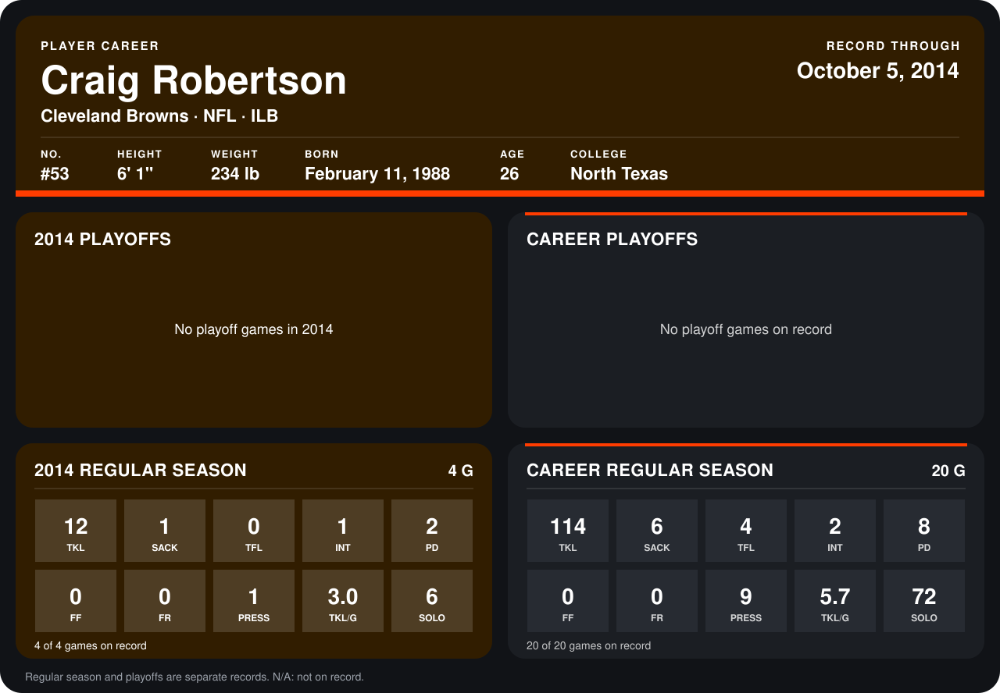

# Craig Robertson

## Career stats

### Regular season

| Season | Team | Age | # | G | TKL | SACK | TFL | INT | PD | FF | FR | PRESS | TKL/G | SOLO |
|---|---|---:|---:|---:|---:|---:|---:|---:|---:|---:|---:|---:|---:|---:|
| 2013 | Cleveland Browns | 25 | 53 | 16 | 102 | 5 | 4 | 1 | 6 | 0 | 0 | 8 | 6.4 | 66 |
| 2014 | Cleveland Browns | 26 | 53 | 4 | 12 | 1 | 0 | 1 | 2 | 0 | 0 | 1 | 3.0 | 6 |
| **Career** |  |  |  | 20 | 114 | 6 | 4 | 2 | 8 | 0 | 0 | 9 | 5.7 | 72 |

### Playoffs

No playoff games on record.

## Awards

None on record.

Age is his age on the league's opening game of each season; # is the number listed for him that season with that team (2014: the card's rule; 2013: the 2013 season roster), N/A where no listing applies.

Records through October 5, 2014. Identity: listed 2014 roster data, Weeks 1-4; number: 2014 Week 1 roster. [All Cleveland Browns players](README.md).
