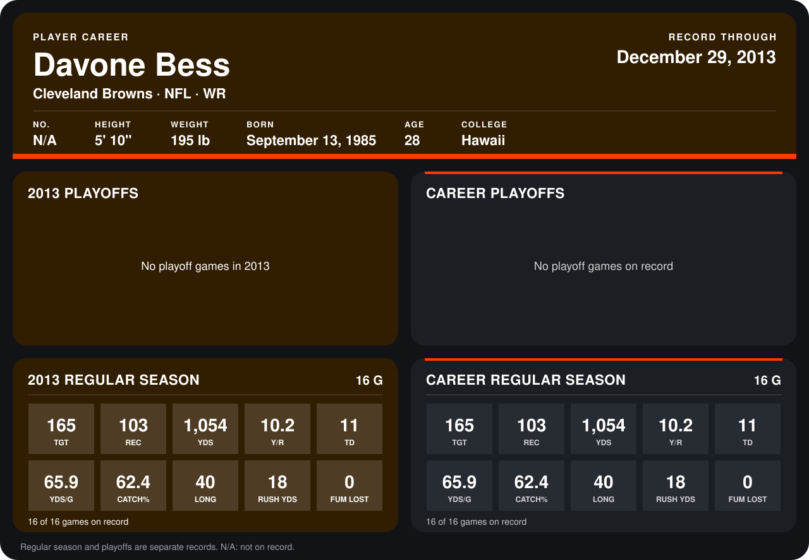

# Davone Bess

## Career stats

### Regular season

| Season | Club | G | TGT | REC | YDS | Y/R | TD | YDS/G | CATCH% | LONG | RUSH YDS | FUM LOST |
|---|---|---:|---:|---:|---:|---:|---:|---:|---:|---:|---:|---:|
| 2013 | Cleveland Browns | 16 | 165 | 103 | 1,054 | 10.2 | 11 | 65.9 | 62.4 | 40 | 18 | 0 |
| **Career** |  | 16 | 165 | 103 | 1,054 | 10.2 | 11 | 65.9 | 62.4 | 40 | 18 | 0 |

### Playoffs

No playoff games on record.

## Awards

- Pro Bowl selection (2013, WR)

Records through December 29, 2013. Identity: his listed 2013 season roster data (no 2014 Weeks 1-4 roster row). [All Cleveland Browns players](README.md).
