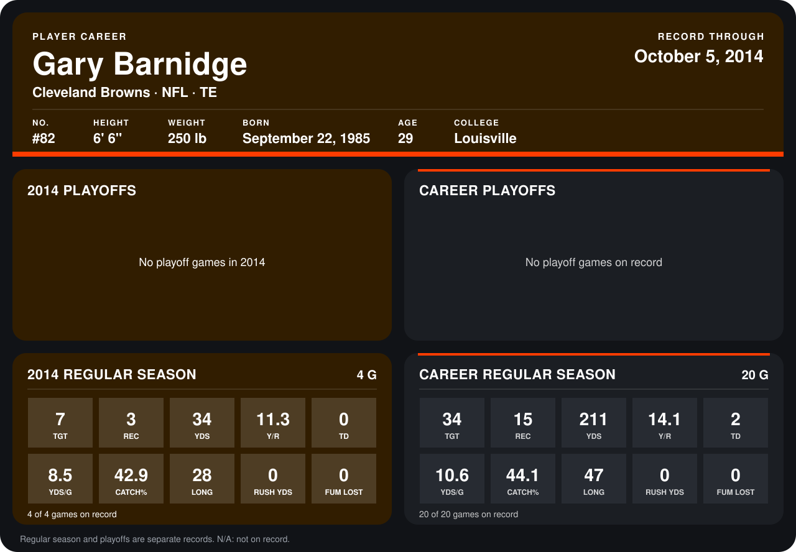

# Gary Barnidge

## Career stats

### Regular season

| Season | Team | Age | # | G | TGT | REC | YDS | Y/R | TD | YDS/G | CATCH% | LONG | RUSH YDS | FUM LOST |
|---|---|---:|---:|---:|---:|---:|---:|---:|---:|---:|---:|---:|---:|---:|
| 2013 | Cleveland Browns | 27 | 82 | 16 | 27 | 12 | 177 | 14.8 | 2 | 11.1 | 44.4 | 47 | 0 | 0 |
| 2014 | Cleveland Browns | 28 | 82 | 3 | 7 | 3 | 34 | 11.3 | 0 | 11.3 | 42.9 | 28 | 0 | 0 |
| **Career** |  |  |  | 19 | 34 | 15 | 211 | 14.1 | 2 | 11.1 | 44.1 | 47 | 0 | 0 |

### Playoffs

No playoff games on record.

## Awards

None on record.

Age is his age on the league's opening game of each season; # is the number listed for him that season with that team (2014: the card's rule; 2013: the 2013 season roster), N/A where no listing applies.

Records through September 21, 2014. Identity: listed 2014 roster data, Weeks 1-4; number: 2014 Week 1 roster. [All Cleveland Browns players](README.md).
