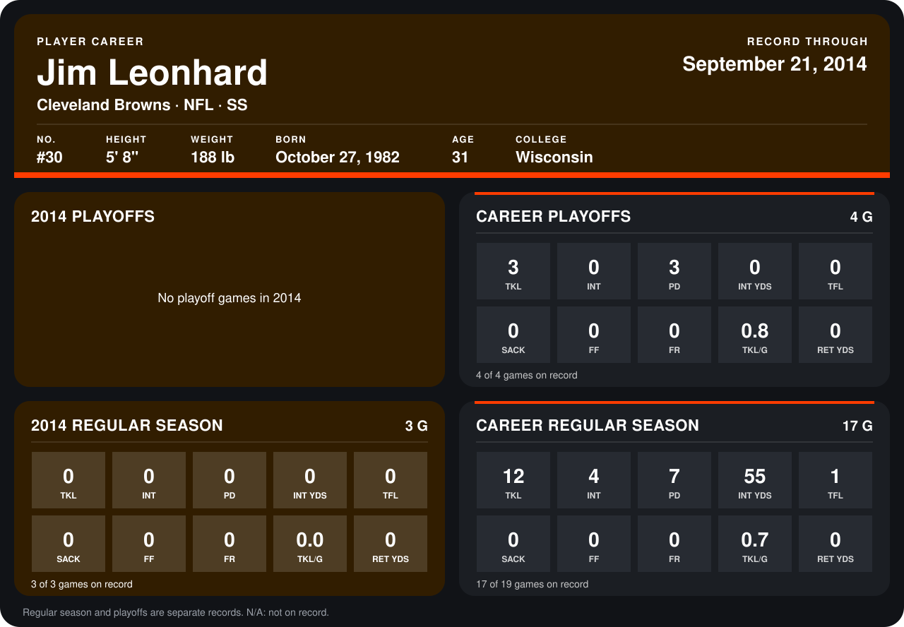

# Jim Leonhard

## Career stats

### Regular season

| Season | Team | Age | # | G | TKL | INT | PD | INT YDS | TFL | SACK | FF | FR | TKL/G | RET YDS |
|---|---|---:|---:|---:|---:|---:|---:|---:|---:|---:|---:|---:|---:|---:|
| 2013 | Buffalo Bills | 30 | 35 | 14 | 12 | 4 | 7 | 55 | 1 | 0 | 0 | 0 | 0.9 | 0 |
| 2014 | Cleveland Browns | 31 | 30 | 3 | 0 | 0 | 0 | 0 | 0 | 0 | 0 | 0 | 0.0 | 0 |
| **Career** |  |  |  | 17 | 12 | 4 | 7 | 55 | 1 | 0 | 0 | 0 | 0.7 | 0 |

### Playoffs

| Season | Team | Age | # | G | TKL | INT | PD | INT YDS | TFL | SACK | FF | FR | TKL/G | RET YDS |
|---|---|---:|---:|---:|---:|---:|---:|---:|---:|---:|---:|---:|---:|---:|
| 2013 | Buffalo Bills | 30 | 35 | 4 | 3 | 0 | 3 | 0 | 0 | 0 | 0 | 0 | 0.8 | 0 |
| **Career** |  |  |  | 4 | 3 | 0 | 3 | 0 | 0 | 0 | 0 | 0 | 0.8 | 0 |

## Awards

None on record.

Age is his age on the league's opening game of each season; # is the number listed for him that season with that team (2014: the card's rule; 2013: the 2013 season roster), N/A where no listing applies.

Records through September 21, 2014. Identity: listed 2014 roster data, Weeks 1-4; number: 2014 Week 1 roster. [All Cleveland Browns players](README.md).
