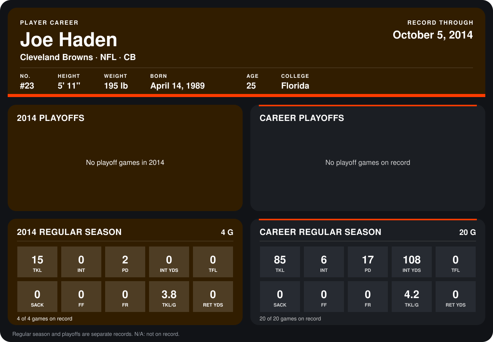

# Joe Haden

## Career stats

### Regular season

| Season | Club | G | TKL | INT | PD | INT YDS | TFL | SACK | FF | FR | TKL/G | RET YDS |
|---|---|---:|---:|---:|---:|---:|---:|---:|---:|---:|---:|---:|
| 2013 | Cleveland Browns | 16 | 70 | 6 | 15 | 108 | 0 | 0 | 0 | 0 | 4.4 | 0 |
| 2014 | Cleveland Browns | 3 | 12 | 0 | 1 | 0 | 0 | 0 | 0 | 0 | 4.0 | 0 |
| **Career** |  | 19 | 82 | 6 | 16 | 108 | 0 | 0 | 0 | 0 | 4.3 | 0 |

### Playoffs

No playoff games on record.

## Awards

- AFC Defensive Player of the Week (2013, Week 13)

Records through September 21, 2014. Identity: listed 2014 roster data, Weeks 1-4; number: 2014 Week 1 roster. [All Cleveland Browns players](README.md).
