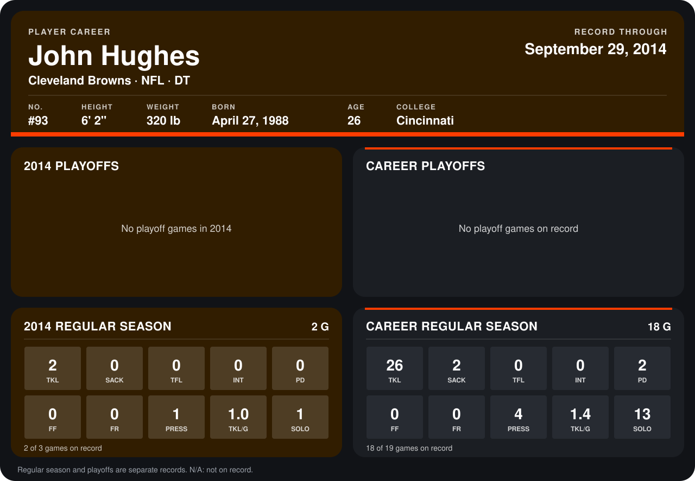

# John Hughes

## Career stats

### Regular season

| Season | Club | G | TKL | SACK | TFL | INT | PD | FF | FR | PRESS | TKL/G | SOLO |
|---|---|---:|---:|---:|---:|---:|---:|---:|---:|---:|---:|---:|
| 2013 | Cleveland Browns | 16 | 24 | 2 | 0 | 0 | 2 | 0 | 0 | 3 | 1.5 | 12 |
| 2014 | Cleveland Browns | 2 | 2 | 0 | 0 | 0 | 0 | 0 | 0 | 1 | 1.0 | 1 |
| **Career** |  | 18 | 26 | 2 | 0 | 0 | 2 | 0 | 0 | 4 | 1.4 | 13 |

### Playoffs

No playoff games on record.

## Awards

None on record.

Records through September 21, 2014. Identity: listed 2014 roster data, Weeks 1-4; number: 2014 Week 1 roster. [All Cleveland Browns players](README.md).
