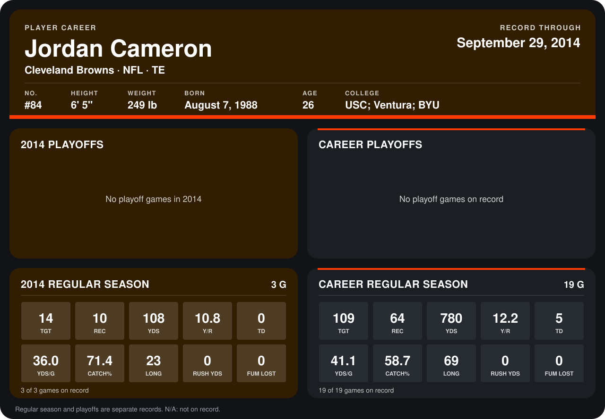

# Jordan Cameron

## Career stats

### Regular season

| Season | Club | G | TGT | REC | YDS | Y/R | TD | YDS/G | CATCH% | LONG | RUSH YDS | FUM LOST |
|---|---|---:|---:|---:|---:|---:|---:|---:|---:|---:|---:|---:|
| 2013 | Cleveland Browns | 16 | 95 | 54 | 672 | 12.4 | 5 | 42.0 | 56.8 | 69 | 0 | 0 |
| 2014 | Cleveland Browns | 4 | 19 | 14 | 170 | 12.1 | 0 | 42.5 | 73.7 | 23 | 0 | 0 |
| **Career** |  | 20 | 114 | 68 | 842 | 12.4 | 5 | 42.1 | 59.6 | 69 | 0 | 0 |

### Playoffs

No playoff games on record.

## Awards

- Pro Bowl selection (2013, TE)

Records through October 5, 2014. Identity: listed 2014 roster data, Weeks 1-4; number: 2014 Week 1 roster. [All Cleveland Browns players](README.md).
