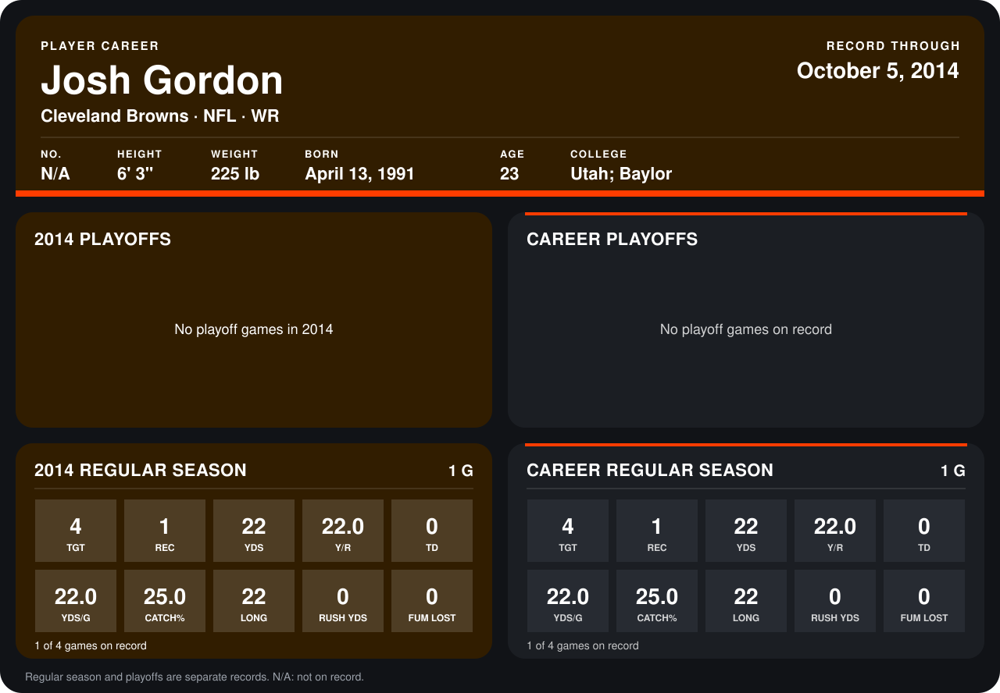

# Josh Gordon

## Career stats

### Regular season

| Season | Club | G | TGT | REC | YDS | Y/R | TD | YDS/G | CATCH% | LONG | RUSH YDS | FUM LOST |
|---|---|---:|---:|---:|---:|---:|---:|---:|---:|---:|---:|---:|
| 2014 | Cleveland Browns | 1 | 4 | 1 | 22 | 22.0 | 0 | 22.0 | 25.0 | 22 | 0 | 0 |
| **Career** |  | 1 | 4 | 1 | 22 | 22.0 | 0 | 22.0 | 25.0 | 22 | 0 | 0 |

### Playoffs

No playoff games on record.

## Awards

None on record.

Records through October 5, 2014. Identity: his listed 2013 season roster data (no 2014 Weeks 1-4 roster row). [All Cleveland Browns players](README.md).
