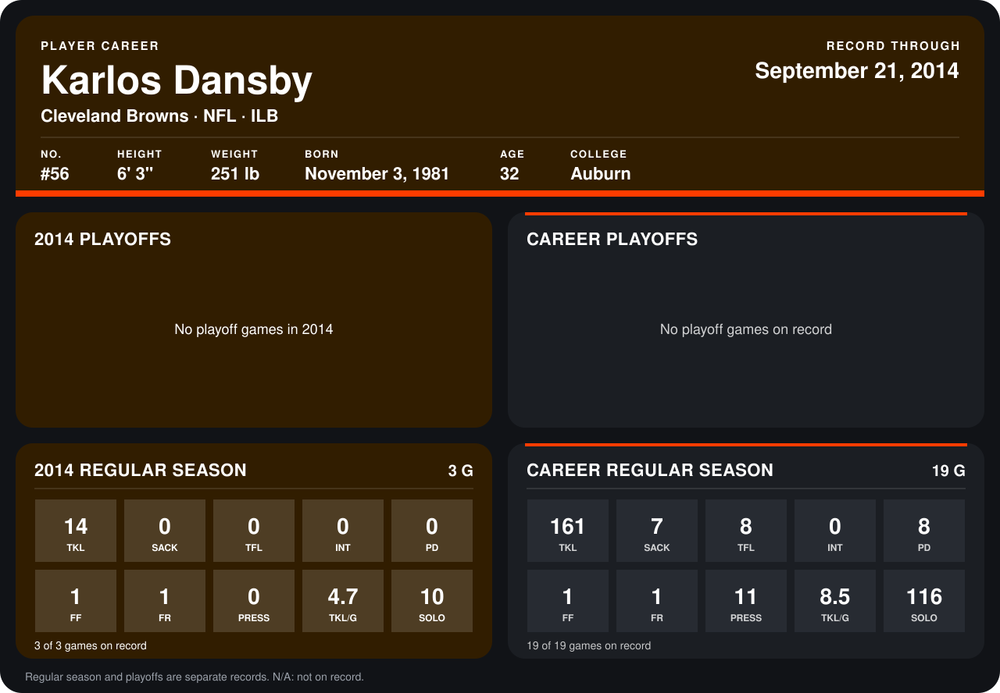

# Karlos Dansby

## Career stats

### Regular season

| Season | Club | G | TKL | SACK | TFL | INT | PD | FF | FR | PRESS | TKL/G | SOLO |
|---|---|---:|---:|---:|---:|---:|---:|---:|---:|---:|---:|---:|
| 2013 | Arizona Cardinals | 16 | 147 | 7 | 8 | 0 | 8 | 0 | 0 | 11 | 9.2 | 106 |
| 2014 | Cleveland Browns | 3 | 14 | 0 | 0 | 0 | 0 | 1 | 1 | 0 | 4.7 | 10 |
| **Career** |  | 19 | 161 | 7 | 8 | 0 | 8 | 1 | 1 | 11 | 8.5 | 116 |

### Playoffs

No playoff games on record.

## Awards

None on record.

Records through September 21, 2014. Identity: listed 2014 roster data, Weeks 1-4; number: 2014 Week 1 roster. [All Cleveland Browns players](README.md).
