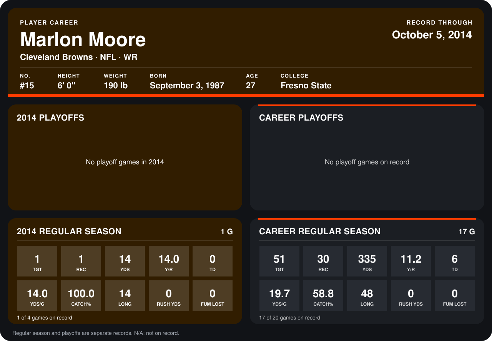

# Marlon Moore

## Career stats

### Regular season

| Season | Club | G | TGT | REC | YDS | Y/R | TD | YDS/G | CATCH% | LONG | RUSH YDS | FUM LOST |
|---|---|---:|---:|---:|---:|---:|---:|---:|---:|---:|---:|---:|
| 2013 | San Francisco 49ers | 16 | 50 | 29 | 321 | 11.1 | 6 | 20.1 | 58.0 | 48 | 0 | 0 |
| 2014 | Cleveland Browns | 1 | 1 | 1 | 14 | 14.0 | 0 | 14.0 | 100.0 | 14 | 0 | 0 |
| **Career** |  | 17 | 51 | 30 | 335 | 11.2 | 6 | 19.7 | 58.8 | 48 | 0 | 0 |

### Playoffs

No playoff games on record.

## Awards

None on record.

Records through October 5, 2014. Identity: listed 2014 roster data, Weeks 1-4; number: 2014 Week 4 roster listing. [All Cleveland Browns players](README.md).
