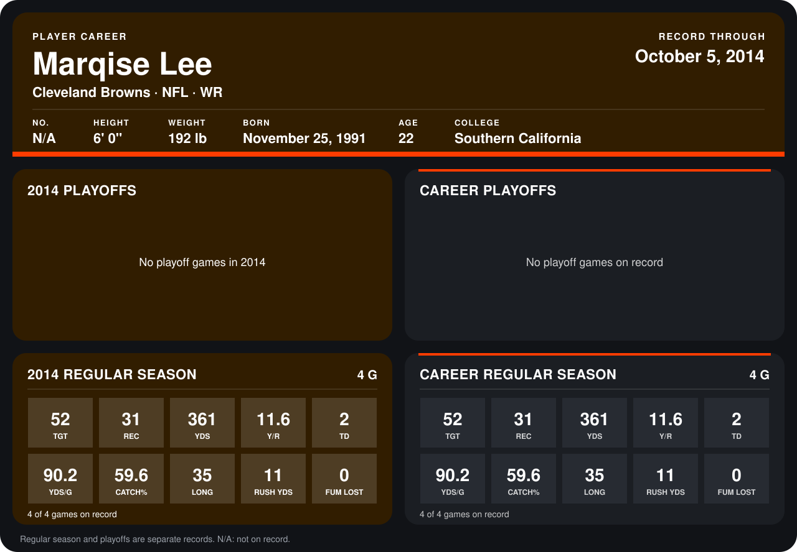

# Marqise Lee

## Career stats

### Regular season

| Season | Club | G | TGT | REC | YDS | Y/R | TD | YDS/G | CATCH% | LONG | RUSH YDS | FUM LOST |
|---|---|---:|---:|---:|---:|---:|---:|---:|---:|---:|---:|---:|
| 2014 | Cleveland Browns | 4 | 52 | 31 | 361 | 11.6 | 2 | 90.2 | 59.6 | 35 | 11 | 0 |
| **Career** |  | 4 | 52 | 31 | 361 | 11.6 | 2 | 90.2 | 59.6 | 35 | 11 | 0 |

### Playoffs

No playoff games on record.

## Awards

None on record.

Records through October 5, 2014. Identity: listed 2014 roster data, Weeks 1-4. [All Cleveland Browns players](README.md).
