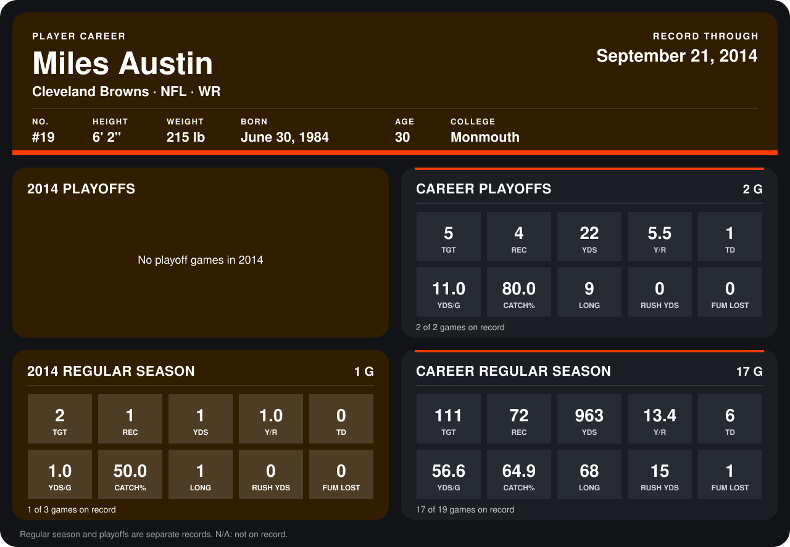

# Miles Austin

## Career stats

### Regular season

| Season | Club | G | TGT | REC | YDS | Y/R | TD | YDS/G | CATCH% | LONG | RUSH YDS | FUM LOST |
|---|---|---:|---:|---:|---:|---:|---:|---:|---:|---:|---:|---:|
| 2013 | Dallas Cowboys | 16 | 109 | 71 | 962 | 13.5 | 6 | 60.1 | 65.1 | 68 | 15 | 1 |
| 2014 | Cleveland Browns | 1 | 2 | 1 | 1 | 1.0 | 0 | 1.0 | 50.0 | 1 | 0 | 0 |
| **Career** |  | 17 | 111 | 72 | 963 | 13.4 | 6 | 56.6 | 64.9 | 68 | 15 | 1 |

### Playoffs

| Season | Club | G | TGT | REC | YDS | Y/R | TD | YDS/G | CATCH% | LONG | RUSH YDS | FUM LOST |
|---|---|---:|---:|---:|---:|---:|---:|---:|---:|---:|---:|---:|
| 2013 | Dallas Cowboys | 2 | 5 | 4 | 22 | 5.5 | 1 | 11.0 | 80.0 | 9 | 0 | 0 |
| **Career** |  | 2 | 5 | 4 | 22 | 5.5 | 1 | 11.0 | 80.0 | 9 | 0 | 0 |

## Awards

None on record.

Records through October 5, 2014. Identity: listed 2014 roster data, Weeks 1-4; number: 2014 Week 1 roster. [All Cleveland Browns players](README.md).
