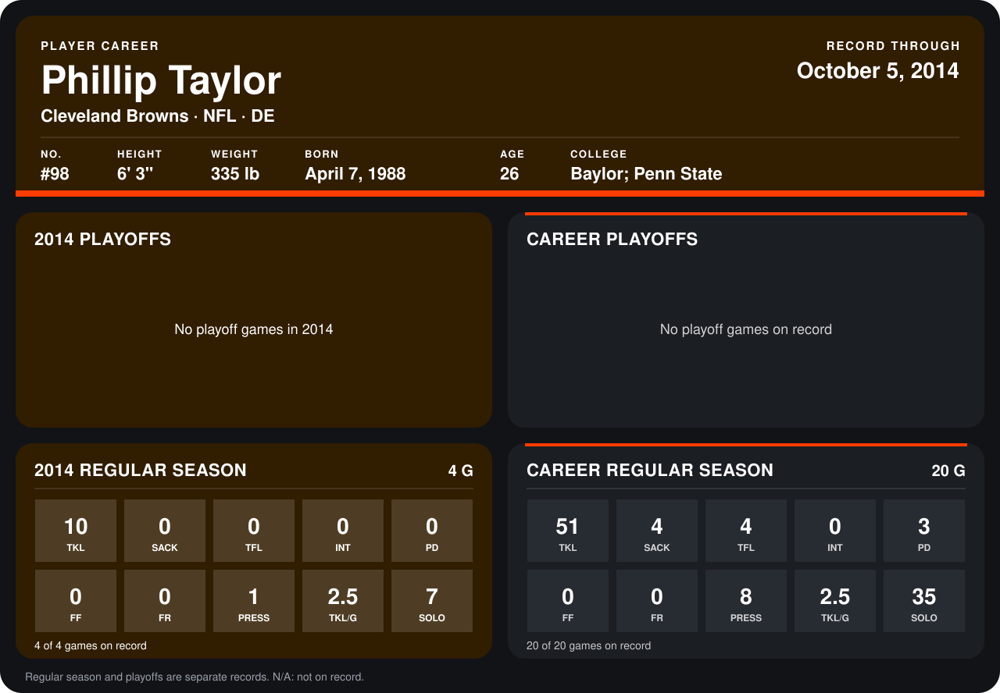

# Phillip Taylor

## Career stats

### Regular season

| Season | Club | G | TKL | SACK | TFL | INT | PD | FF | FR | PRESS | TKL/G | SOLO |
|---|---|---:|---:|---:|---:|---:|---:|---:|---:|---:|---:|---:|
| 2013 | Cleveland Browns | 16 | 41 | 4 | 4 | 0 | 3 | 0 | 0 | 7 | 2.6 | 28 |
| 2014 | Cleveland Browns | 3 | 5 | 0 | 0 | 0 | 0 | 0 | 0 | 1 | 1.7 | 5 |
| **Career** |  | 19 | 46 | 4 | 4 | 0 | 3 | 0 | 0 | 8 | 2.4 | 33 |

### Playoffs

No playoff games on record.

## Awards

None on record.

Records through September 29, 2014. Identity: listed 2014 roster data, Weeks 1-4; number: 2014 Week 1 roster. [All Cleveland Browns players](README.md).
