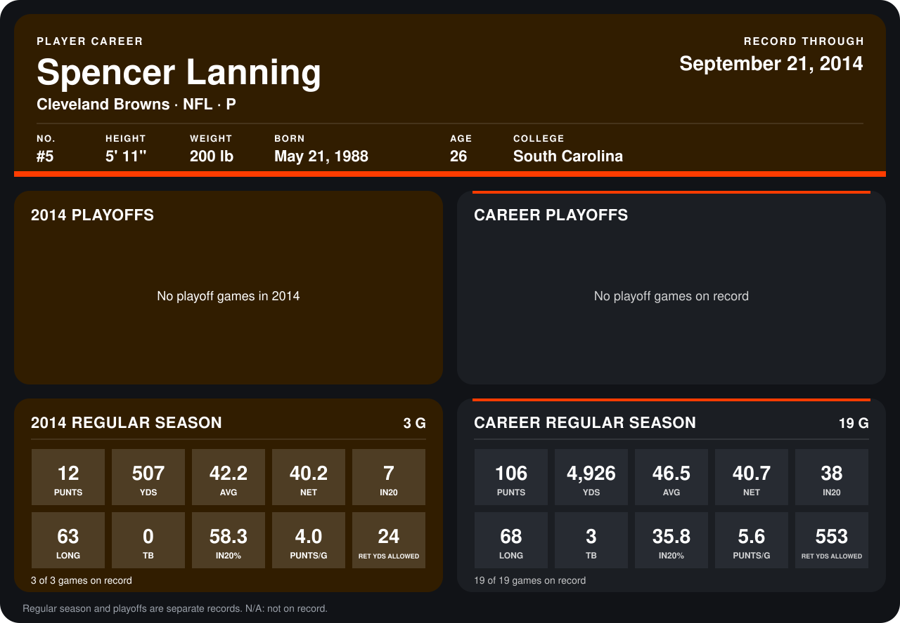

# Spencer Lanning

## Career stats

### Regular season

| Season | Club | G | PUNTS | YDS | AVG | NET | IN20 | LONG | TB | IN20% | PUNTS/G | RET YDS ALLOWED |
|---|---|---:|---:|---:|---:|---:|---:|---:|---:|---:|---:|---:|
| 2013 | Cleveland Browns | 16 | 94 | 4,419 | 47.0 | 40.7 | 31 | 68 | 3 | 33.0 | 5.9 | 529 |
| 2014 | Cleveland Browns | 4 | 19 | 829 | 43.6 | 40.5 | 11 | 66 | 2 | 57.9 | 4.8 | 20 |
| **Career** |  | 20 | 113 | 5,248 | 46.4 | 40.7 | 42 | 68 | 5 | 37.2 | 5.7 | 549 |

### Playoffs

No playoff games on record.

## Awards

- AFC Special Teams Player of the Week (2013, Week 5)
- AFC Special Teams Player of the Week (2013, Week 11)
- AP First-Team All-Pro (2013, P)
- Pro Bowl selection (2013, P)

Records through October 5, 2014. Identity: listed 2014 roster data, Weeks 1-4; number: 2014 Week 1 roster. [All Cleveland Browns players](README.md).
