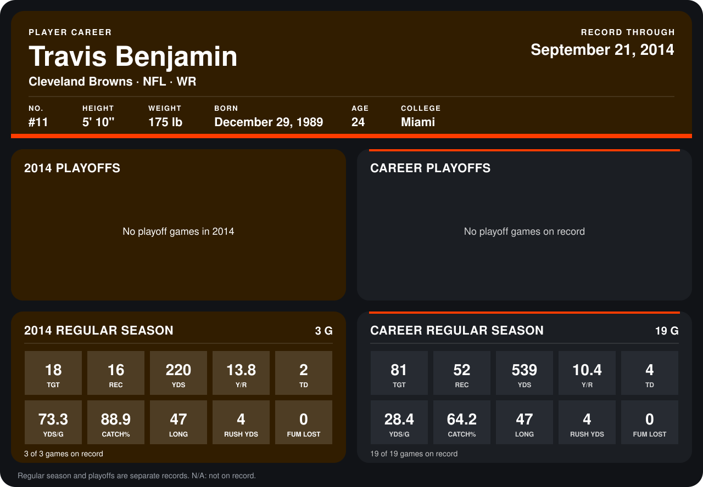

# Travis Benjamin

## Career stats

### Regular season

| Season | Team | Age | # | G | TGT | REC | YDS | Y/R | TD | YDS/G | CATCH% | LONG | RUSH YDS | FUM LOST |
|---|---|---:|---:|---:|---:|---:|---:|---:|---:|---:|---:|---:|---:|---:|
| 2013 | Cleveland Browns | 23 | 80 | 16 | 63 | 36 | 319 | 8.9 | 2 | 19.9 | 57.1 | 43 | 0 | 0 |
| 2014 | Cleveland Browns | 24 | 11 | 3 | 18 | 16 | 220 | 13.8 | 2 | 73.3 | 88.9 | 47 | 4 | 0 |
| **Career** |  |  |  | 19 | 81 | 52 | 539 | 10.4 | 4 | 28.4 | 64.2 | 47 | 4 | 0 |

### Playoffs

No playoff games on record.

## Awards

None on record.

Age is his age on the league's opening game of each season; # is the number listed for him that season with that team (2014: the card's rule; 2013: the 2013 season roster), N/A where no listing applies.

Records through September 21, 2014. Identity: listed 2014 roster data, Weeks 1-4; number: 2014 Week 1 roster. [All Cleveland Browns players](README.md).
