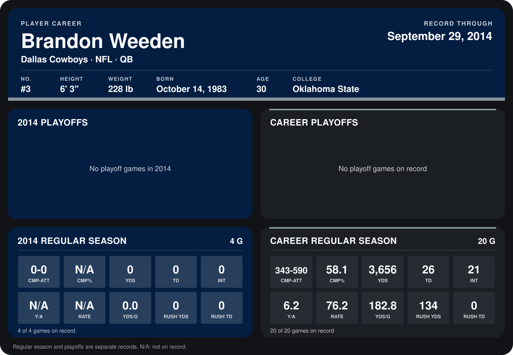

# Brandon Weeden

## Career stats

### Regular season

| Season | Club | G | CMP-ATT | CMP% | YDS | TD | INT | Y/A | RATE | YDS/G | RUSH YDS | RUSH TD |
|---|---|---:|---:|---:|---:|---:|---:|---:|---:|---:|---:|---:|
| 2013 | Cleveland Browns | 16 | 343-590 | 58.1 | 3,656 | 26 | 21 | 6.2 | 76.2 | 228.5 | 134 | 0 |
| 2014 | Dallas Cowboys | 4 | 0-0 | N/A | 0 | 0 | 0 | N/A | N/A | 0.0 | 0 | 0 |
| **Career** |  | 20 | 343-590 | 58.1 | 3,656 | 26 | 21 | 6.2 | 76.2 | 182.8 | 134 | 0 |

### Playoffs

No playoff games on record.

## Awards

None on record.

Records through September 29, 2014. Identity: listed 2014 roster data, Weeks 1-4; number: 2014 Week 1 roster. [All Dallas Cowboys players](README.md).
