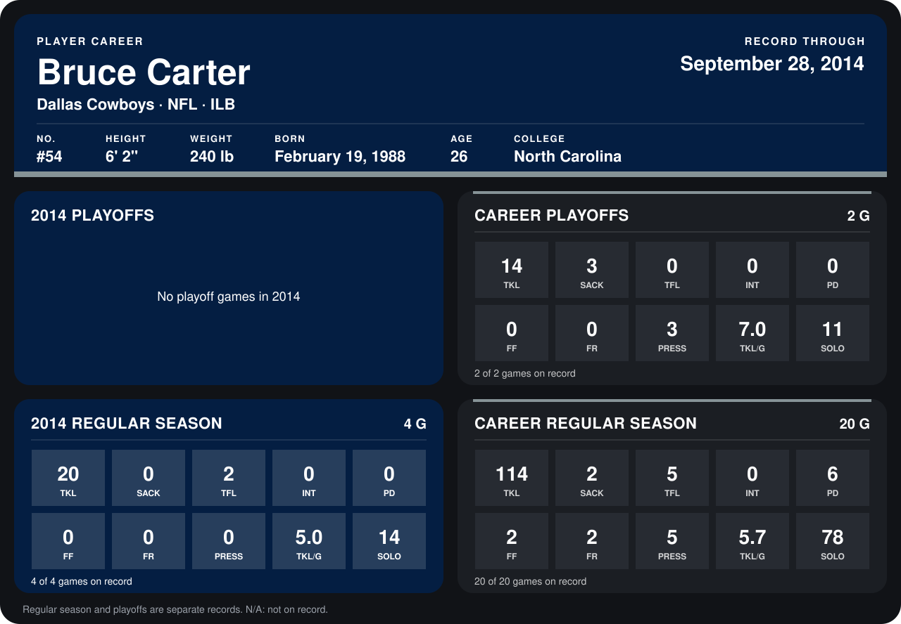

# Bruce Carter

## Career stats

### Regular season

| Season | Club | G | TKL | SACK | TFL | INT | PD | FF | FR | PRESS | TKL/G | SOLO |
|---|---|---:|---:|---:|---:|---:|---:|---:|---:|---:|---:|---:|
| 2013 | Dallas Cowboys | 16 | 94 | 2 | 3 | 0 | 6 | 2 | 2 | 5 | 5.9 | 64 |
| 2014 | Dallas Cowboys | 4 | 20 | 0 | 2 | 0 | 0 | 0 | 0 | 0 | 5.0 | 14 |
| **Career** |  | 20 | 114 | 2 | 5 | 0 | 6 | 2 | 2 | 5 | 5.7 | 78 |

### Playoffs

| Season | Club | G | TKL | SACK | TFL | INT | PD | FF | FR | PRESS | TKL/G | SOLO |
|---|---|---:|---:|---:|---:|---:|---:|---:|---:|---:|---:|---:|
| 2013 | Dallas Cowboys | 2 | 14 | 3 | 0 | 0 | 0 | 0 | 0 | 3 | 7.0 | 11 |
| **Career** |  | 2 | 14 | 3 | 0 | 0 | 0 | 0 | 0 | 3 | 7.0 | 11 |

## Awards

None on record.

Records through September 28, 2014. Identity: listed 2014 roster data, Weeks 1-4; number: 2014 Week 1 roster. [All Dallas Cowboys players](README.md).
