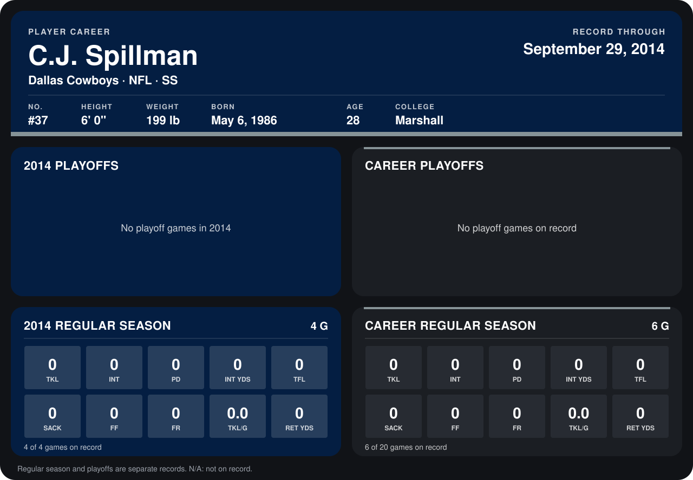

# C.J. Spillman

## Career stats

### Regular season

| Season | Club | G | TKL | INT | PD | INT YDS | TFL | SACK | FF | FR | TKL/G | RET YDS |
|---|---|---:|---:|---:|---:|---:|---:|---:|---:|---:|---:|---:|
| 2013 | San Francisco 49ers | 2 | 0 | 0 | 0 | 0 | 0 | 0 | 0 | 0 | 0.0 | 0 |
| 2014 | Dallas Cowboys | 5 | 1 | 0 | 0 | 0 | 0 | 0 | 0 | 0 | 0.2 | 0 |
| **Career** |  | 7 | 1 | 0 | 0 | 0 | 0 | 0 | 0 | 0 | 0.1 | 0 |

### Playoffs

No playoff games on record.

## Awards

None on record.

Records through October 5, 2014. Identity: listed 2014 roster data, Weeks 1-4; number: 2014 Week 1 roster. [All Dallas Cowboys players](README.md).
