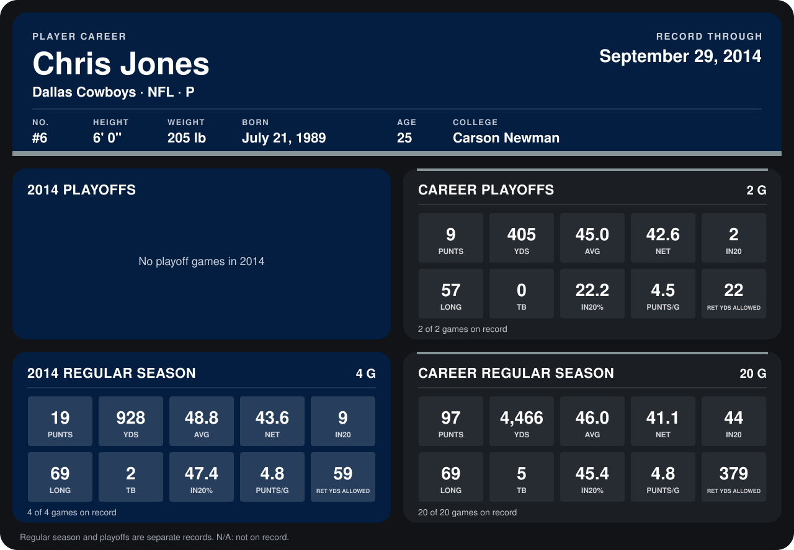

# Chris Jones

## Career stats

### Regular season

| Season | Club | G | PUNTS | YDS | AVG | NET | IN20 | LONG | TB | IN20% | PUNTS/G | RET YDS ALLOWED |
|---|---|---:|---:|---:|---:|---:|---:|---:|---:|---:|---:|---:|
| 2013 | Dallas Cowboys | 16 | 78 | 3,538 | 45.4 | 40.5 | 35 | 66 | 3 | 44.9 | 4.9 | 320 |
| 2014 | Dallas Cowboys | 4 | 19 | 928 | 48.8 | 43.6 | 9 | 69 | 2 | 47.4 | 4.8 | 59 |
| **Career** |  | 20 | 97 | 4,466 | 46.0 | 41.1 | 44 | 69 | 5 | 45.4 | 4.8 | 379 |

### Playoffs

| Season | Club | G | PUNTS | YDS | AVG | NET | IN20 | LONG | TB | IN20% | PUNTS/G | RET YDS ALLOWED |
|---|---|---:|---:|---:|---:|---:|---:|---:|---:|---:|---:|---:|
| 2013 | Dallas Cowboys | 2 | 9 | 405 | 45.0 | 42.6 | 2 | 57 | 0 | 22.2 | 4.5 | 22 |
| **Career** |  | 2 | 9 | 405 | 45.0 | 42.6 | 2 | 57 | 0 | 22.2 | 4.5 | 22 |

## Awards

- NFC Special Teams Player of the Week (2013, Week 10)

Records through September 28, 2014. Identity: listed 2014 roster data, Weeks 1-4; number: 2014 Week 1 roster. [All Dallas Cowboys players](README.md).
