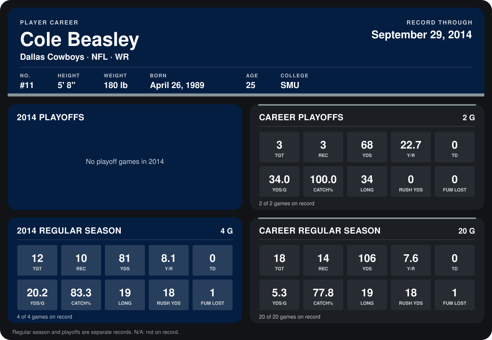

# Cole Beasley

## Career stats

### Regular season

| Season | Team | Age | # | G | TGT | REC | YDS | Y/R | TD | YDS/G | CATCH% | LONG | RUSH YDS | FUM LOST |
|---|---|---:|---:|---:|---:|---:|---:|---:|---:|---:|---:|---:|---:|---:|
| 2013 | Dallas Cowboys | 24 | 11 | 16 | 6 | 4 | 25 | 6.2 | 0 | 1.6 | 66.7 | 14 | 0 | 0 |
| 2014 | Dallas Cowboys | 25 | 11 | 5 | 17 | 15 | 101 | 6.7 | 0 | 20.2 | 88.2 | 19 | 18 | 1 |
| **Career** |  |  |  | 21 | 23 | 19 | 126 | 6.6 | 0 | 6.0 | 82.6 | 19 | 18 | 1 |

### Playoffs

| Season | Team | Age | # | G | TGT | REC | YDS | Y/R | TD | YDS/G | CATCH% | LONG | RUSH YDS | FUM LOST |
|---|---|---:|---:|---:|---:|---:|---:|---:|---:|---:|---:|---:|---:|---:|
| 2013 | Dallas Cowboys | 24 | 11 | 2 | 3 | 3 | 68 | 22.7 | 0 | 34.0 | 100.0 | 34 | 0 | 0 |
| **Career** |  |  |  | 2 | 3 | 3 | 68 | 22.7 | 0 | 34.0 | 100.0 | 34 | 0 | 0 |

## Awards

None on record.

Age is his age on the league's opening game of each season; # is the number listed for him that season with that team (2014: the card's rule; 2013: the 2013 season roster), N/A where no listing applies.

Records through October 5, 2014. Identity: listed 2014 roster data, Weeks 1-4; number: 2014 Week 1 roster. [All Dallas Cowboys players](README.md).
