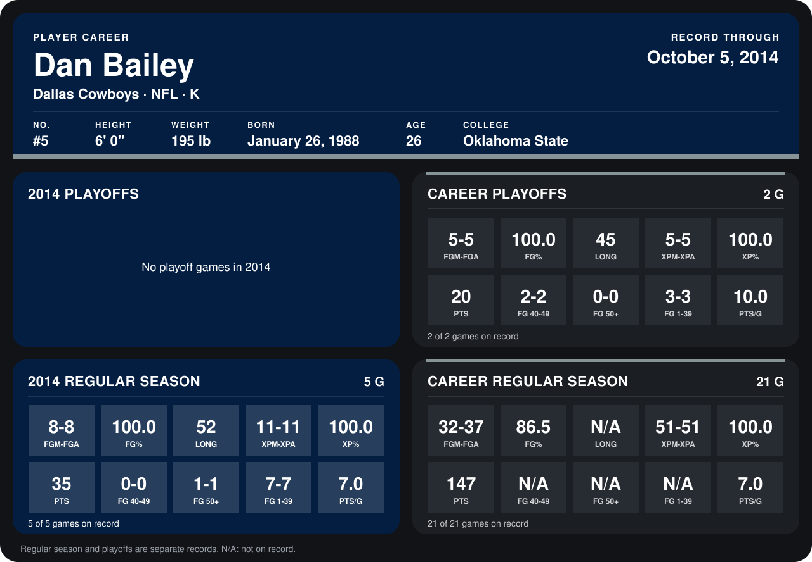

# Dan Bailey

## Career stats

### Regular season

| Season | Team | Age | # | G | FGM-FGA | FG% | LONG | XPM-XPA | XP% | PTS | FG 40-49 | FG 50+ | FG 1-39 | PTS/G |
|---|---|---:|---:|---:|---:|---:|---:|---:|---:|---:|---:|---:|---:|---:|
| 2013 | Dallas Cowboys | 25 | 5 | 16 | 24-29 | 82.8 | N/A | 40-40 | 100.0 | 112 | N/A | N/A | N/A | 7.0 |
| 2014 | Dallas Cowboys | 26 | 5 | 5 | 8-8 | 100.0 | 52 | 11-11 | 100.0 | 35 | 0-0 | 1-1 | 7-7 | 7.0 |
| **Career** |  |  |  | 21 | 32-37 | 86.5 | N/A | 51-51 | 100.0 | 147 | N/A | N/A | N/A | 7.0 |

### Playoffs

| Season | Team | Age | # | G | FGM-FGA | FG% | LONG | XPM-XPA | XP% | PTS | FG 40-49 | FG 50+ | FG 1-39 | PTS/G |
|---|---|---:|---:|---:|---:|---:|---:|---:|---:|---:|---:|---:|---:|---:|
| 2013 | Dallas Cowboys | 25 | 5 | 2 | 5-5 | 100.0 | 45 | 5-5 | 100.0 | 20 | 2-2 | 0-0 | 3-3 | 10.0 |
| **Career** |  |  |  | 2 | 5-5 | 100.0 | 45 | 5-5 | 100.0 | 20 | 2-2 | 0-0 | 3-3 | 10.0 |

## Awards

- NFC Special Teams Player of the Week (2013, Week 12)

Age is his age on the league's opening game of each season; # is the number listed for him that season with that team (2014: the card's rule; 2013: the 2013 season roster), N/A where no listing applies.

Records through October 5, 2014. Identity: listed 2014 roster data, Weeks 1-4; number: 2014 Week 1 roster. [All Dallas Cowboys players](README.md).
