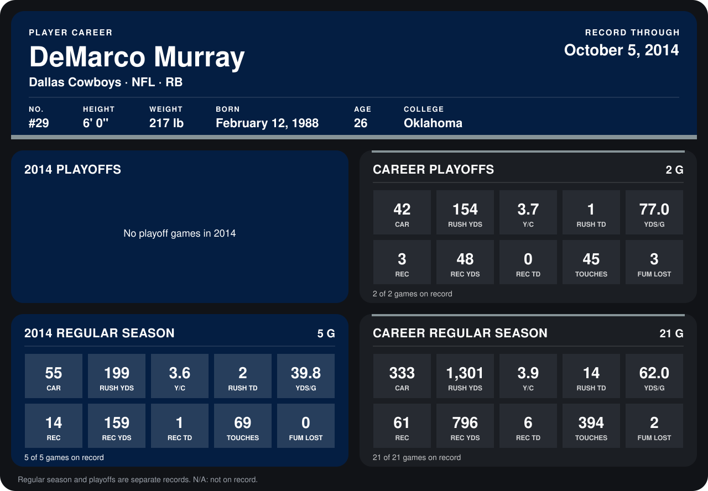

# DeMarco Murray

## Career stats

### Regular season

| Season | Club | G | CAR | RUSH YDS | Y/C | RUSH TD | YDS/G | REC | REC YDS | REC TD | TOUCHES | FUM LOST |
|---|---|---:|---:|---:|---:|---:|---:|---:|---:|---:|---:|---:|
| 2013 | Dallas Cowboys | 16 | 278 | 1,102 | 4.0 | 12 | 68.9 | 47 | 637 | 5 | 325 | 2 |
| 2014 | Dallas Cowboys | 4 | 46 | 152 | 3.3 | 2 | 38.0 | 11 | 120 | 1 | 57 | 0 |
| **Career** |  | 20 | 324 | 1,254 | 3.9 | 14 | 62.7 | 58 | 757 | 6 | 382 | 2 |

### Playoffs

| Season | Club | G | CAR | RUSH YDS | Y/C | RUSH TD | YDS/G | REC | REC YDS | REC TD | TOUCHES | FUM LOST |
|---|---|---:|---:|---:|---:|---:|---:|---:|---:|---:|---:|---:|
| 2013 | Dallas Cowboys | 2 | 42 | 154 | 3.7 | 1 | 77.0 | 3 | 48 | 0 | 45 | 3 |
| **Career** |  | 2 | 42 | 154 | 3.7 | 1 | 77.0 | 3 | 48 | 0 | 45 | 3 |

## Awards

- NFC Offensive Player of the Week (2013, Week 1)
- Pro Bowl selection (2013, RB)

Records through September 28, 2014. Identity: listed 2014 roster data, Weeks 1-4; number: 2014 Week 1 roster. [All Dallas Cowboys players](README.md).
