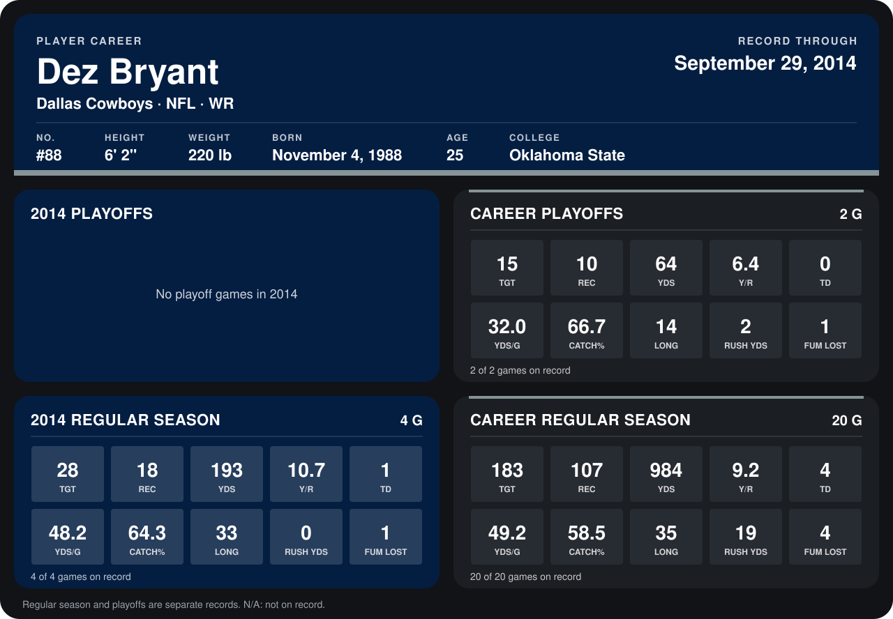

# Dez Bryant

## Career stats

### Regular season

| Season | Club | G | TGT | REC | YDS | Y/R | TD | YDS/G | CATCH% | LONG | RUSH YDS | FUM LOST |
|---|---|---:|---:|---:|---:|---:|---:|---:|---:|---:|---:|---:|
| 2013 | Dallas Cowboys | 16 | 155 | 89 | 791 | 8.9 | 3 | 49.4 | 57.4 | 35 | 19 | 3 |
| 2014 | Dallas Cowboys | 4 | 28 | 18 | 193 | 10.7 | 1 | 48.2 | 64.3 | 33 | 0 | 1 |
| **Career** |  | 20 | 183 | 107 | 984 | 9.2 | 4 | 49.2 | 58.5 | 35 | 19 | 4 |

### Playoffs

| Season | Club | G | TGT | REC | YDS | Y/R | TD | YDS/G | CATCH% | LONG | RUSH YDS | FUM LOST |
|---|---|---:|---:|---:|---:|---:|---:|---:|---:|---:|---:|---:|
| 2013 | Dallas Cowboys | 2 | 15 | 10 | 64 | 6.4 | 0 | 32.0 | 66.7 | 14 | 2 | 1 |
| **Career** |  | 2 | 15 | 10 | 64 | 6.4 | 0 | 32.0 | 66.7 | 14 | 2 | 1 |

## Awards

None on record.

Records through September 28, 2014. Identity: listed 2014 roster data, Weeks 1-4; number: 2014 Week 1 roster. [All Dallas Cowboys players](README.md).
