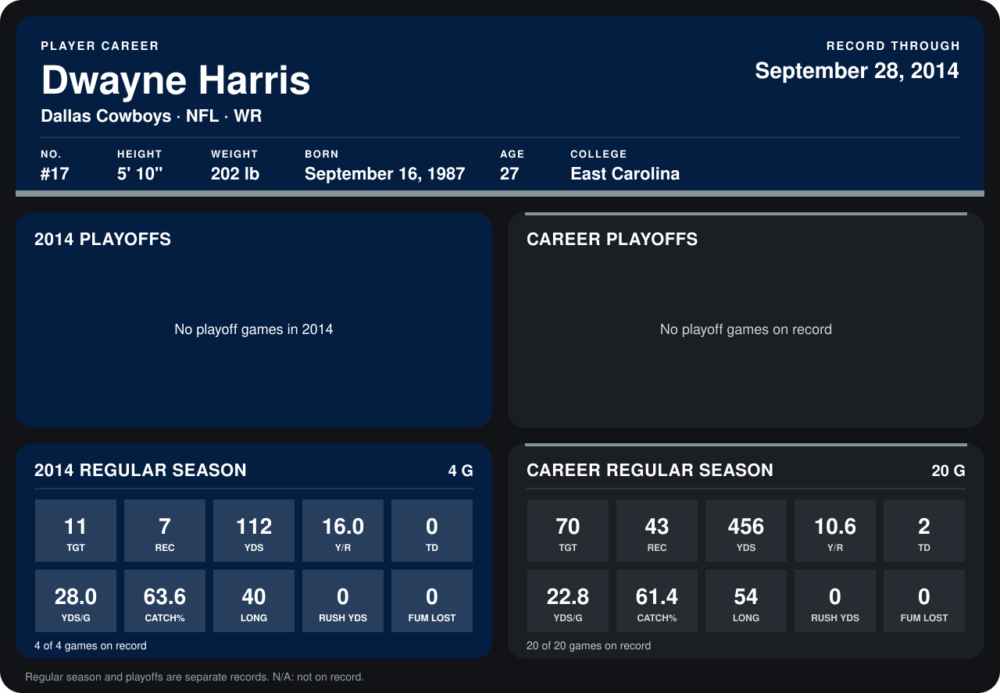

# Dwayne Harris

## Career stats

### Regular season

| Season | Team | Age | # | G | TGT | REC | YDS | Y/R | TD | YDS/G | CATCH% | LONG | RUSH YDS | FUM LOST |
|---|---|---:|---:|---:|---:|---:|---:|---:|---:|---:|---:|---:|---:|---:|
| 2013 | Dallas Cowboys | 25 | 17 | 16 | 59 | 36 | 344 | 9.6 | 2 | 21.5 | 61.0 | 54 | 0 | 0 |
| 2014 | Dallas Cowboys | 26 | 17 | 4 | 11 | 7 | 112 | 16.0 | 0 | 28.0 | 63.6 | 40 | 0 | 0 |
| **Career** |  |  |  | 20 | 70 | 43 | 456 | 10.6 | 2 | 22.8 | 61.4 | 54 | 0 | 0 |

### Playoffs

No playoff games on record.

## Awards

- NFC Special Teams Player of the Week (2013, Week 3)
- NFC Special Teams Player of the Week (2013, Week 17)
- NFC Special Teams Player of the Month (2013, December)

Age is his age on the league's opening game of each season; # is the number listed for him that season with that team (2014: the card's rule; 2013: the 2013 season roster), N/A where no listing applies.

Records through September 28, 2014. Identity: listed 2014 roster data, Weeks 1-4; number: 2014 Week 1 roster. [All Dallas Cowboys players](README.md).
