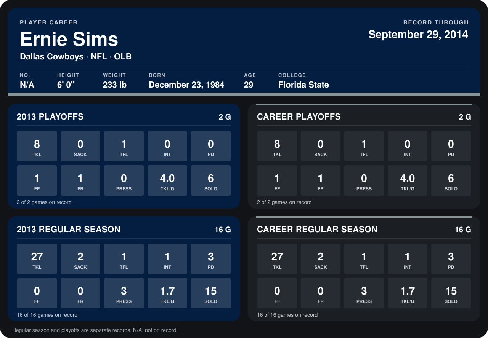

# Ernie Sims

## Career stats

### Regular season

| Season | Club | G | TKL | SACK | TFL | INT | PD | FF | FR | PRESS | TKL/G | SOLO |
|---|---|---:|---:|---:|---:|---:|---:|---:|---:|---:|---:|---:|
| 2013 | Dallas Cowboys | 16 | 27 | 2 | 1 | 1 | 3 | 0 | 0 | 3 | 1.7 | 15 |
| **Career** |  | 16 | 27 | 2 | 1 | 1 | 3 | 0 | 0 | 3 | 1.7 | 15 |

### Playoffs

| Season | Club | G | TKL | SACK | TFL | INT | PD | FF | FR | PRESS | TKL/G | SOLO |
|---|---|---:|---:|---:|---:|---:|---:|---:|---:|---:|---:|---:|
| 2013 | Dallas Cowboys | 2 | 8 | 0 | 1 | 0 | 0 | 1 | 1 | 0 | 4.0 | 6 |
| **Career** |  | 2 | 8 | 0 | 1 | 0 | 0 | 1 | 1 | 0 | 4.0 | 6 |

## Awards

None on record.

Records through September 29, 2014. Identity: the public player file's latest listing (no 2014 Weeks 1-4 roster row). [All Dallas Cowboys players](README.md).
