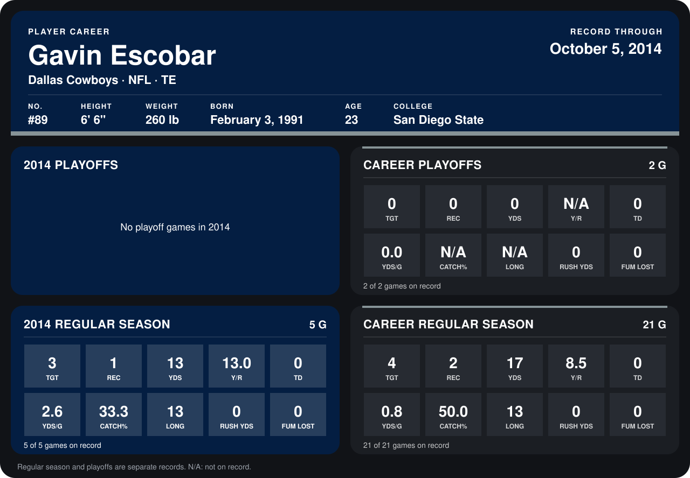

# Gavin Escobar

## Career stats

### Regular season

| Season | Club | G | TGT | REC | YDS | Y/R | TD | YDS/G | CATCH% | LONG | RUSH YDS | FUM LOST |
|---|---|---:|---:|---:|---:|---:|---:|---:|---:|---:|---:|---:|
| 2013 | Dallas Cowboys | 16 | 1 | 1 | 4 | 4.0 | 0 | 0.2 | 100.0 | 4 | 0 | 0 |
| 2014 | Dallas Cowboys | 4 | 3 | 1 | 13 | 13.0 | 0 | 3.2 | 33.3 | 13 | 0 | 0 |
| **Career** |  | 20 | 4 | 2 | 17 | 8.5 | 0 | 0.8 | 50.0 | 13 | 0 | 0 |

### Playoffs

| Season | Club | G | TGT | REC | YDS | Y/R | TD | YDS/G | CATCH% | LONG | RUSH YDS | FUM LOST |
|---|---|---:|---:|---:|---:|---:|---:|---:|---:|---:|---:|---:|
| 2013 | Dallas Cowboys | 2 | 0 | 0 | 0 | N/A | 0 | 0.0 | N/A | N/A | 0 | 0 |
| **Career** |  | 2 | 0 | 0 | 0 | N/A | 0 | 0.0 | N/A | N/A | 0 | 0 |

## Awards

None on record.

Records through September 29, 2014. Identity: listed 2014 roster data, Weeks 1-4; number: 2014 Week 1 roster. [All Dallas Cowboys players](README.md).
