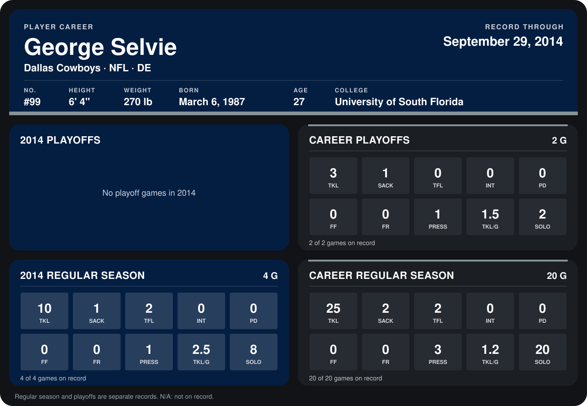

# George Selvie

## Career stats

### Regular season

| Season | Club | G | TKL | SACK | TFL | INT | PD | FF | FR | PRESS | TKL/G | SOLO |
|---|---|---:|---:|---:|---:|---:|---:|---:|---:|---:|---:|---:|
| 2013 | Dallas Cowboys | 16 | 15 | 1 | 0 | 0 | 0 | 0 | 0 | 2 | 0.9 | 12 |
| 2014 | Dallas Cowboys | 5 | 15 | 2 | 3 | 0 | 1 | 1 | 0 | 2 | 3.0 | 11 |
| **Career** |  | 21 | 30 | 3 | 3 | 0 | 1 | 1 | 0 | 4 | 1.4 | 23 |

### Playoffs

| Season | Club | G | TKL | SACK | TFL | INT | PD | FF | FR | PRESS | TKL/G | SOLO |
|---|---|---:|---:|---:|---:|---:|---:|---:|---:|---:|---:|---:|
| 2013 | Dallas Cowboys | 2 | 3 | 1 | 0 | 0 | 0 | 0 | 0 | 1 | 1.5 | 2 |
| **Career** |  | 2 | 3 | 1 | 0 | 0 | 0 | 0 | 0 | 1 | 1.5 | 2 |

## Awards

None on record.

Records through October 5, 2014. Identity: listed 2014 roster data, Weeks 1-4; number: 2014 Week 1 roster. [All Dallas Cowboys players](README.md).
