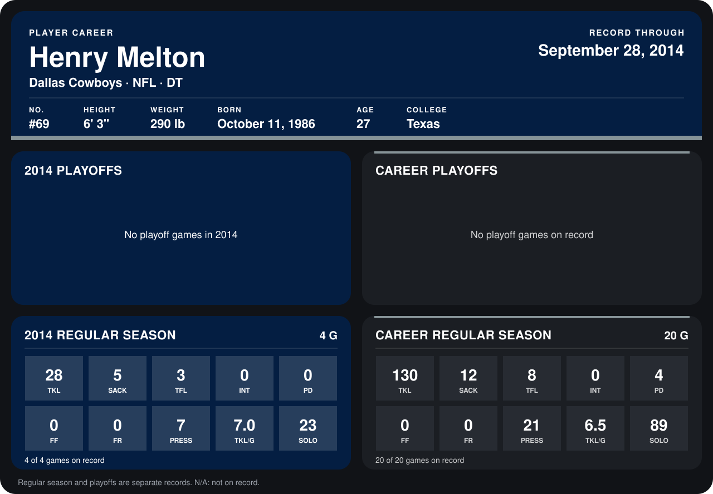

# Henry Melton

## Career stats

### Regular season

| Season | Team | Age | # | G | TKL | SACK | TFL | INT | PD | FF | FR | PRESS | TKL/G | SOLO |
|---|---|---:|---:|---:|---:|---:|---:|---:|---:|---:|---:|---:|---:|---:|
| 2013 | Chicago Bears | 26 | 69 | 16 | 102 | 7 | 5 | 0 | 4 | 0 | 0 | 14 | 6.4 | 66 |
| 2014 | Dallas Cowboys | 27 | 69 | 5 | 36 | 6 | 3 | 0 | 0 | 0 | 0 | 8 | 7.2 | 26 |
| **Career** |  |  |  | 21 | 138 | 13 | 8 | 0 | 4 | 0 | 0 | 22 | 6.6 | 92 |

### Playoffs

No playoff games on record.

## Awards

- Pro Bowl selection (2013, DT)

Age is his age on the league's opening game of each season; # is the number listed for him that season with that team (2014: the card's rule; 2013: the 2013 season roster), N/A where no listing applies.

Records through October 5, 2014. Identity: listed 2014 roster data, Weeks 1-4; number: 2014 Week 1 roster. [All Dallas Cowboys players](README.md).
