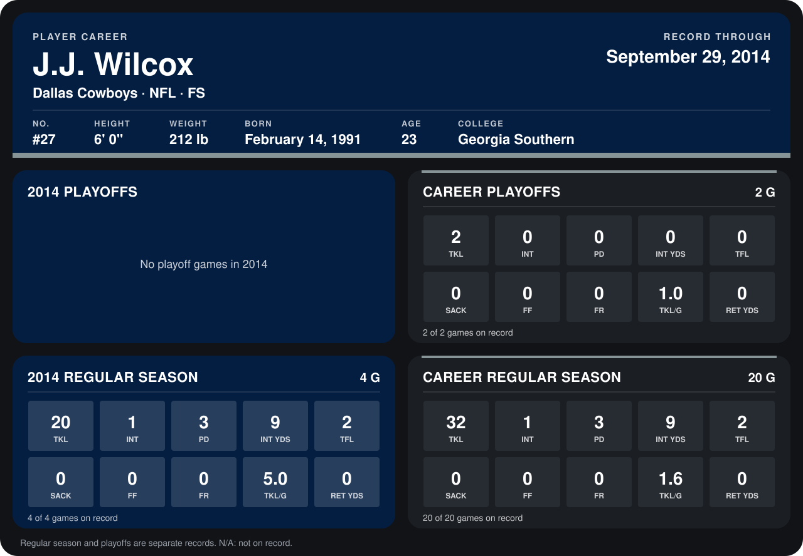

# J.J. Wilcox

## Career stats

### Regular season

| Season | Club | G | TKL | INT | PD | INT YDS | TFL | SACK | FF | FR | TKL/G | RET YDS |
|---|---|---:|---:|---:|---:|---:|---:|---:|---:|---:|---:|---:|
| 2013 | Dallas Cowboys | 16 | 12 | 0 | 0 | 0 | 0 | 0 | 0 | 0 | 0.8 | 0 |
| 2014 | Dallas Cowboys | 5 | 20 | 1 | 3 | 9 | 2 | 0 | 0 | 0 | 4.0 | 0 |
| **Career** |  | 21 | 32 | 1 | 3 | 9 | 2 | 0 | 0 | 0 | 1.5 | 0 |

### Playoffs

| Season | Club | G | TKL | INT | PD | INT YDS | TFL | SACK | FF | FR | TKL/G | RET YDS |
|---|---|---:|---:|---:|---:|---:|---:|---:|---:|---:|---:|---:|
| 2013 | Dallas Cowboys | 2 | 2 | 0 | 0 | 0 | 0 | 0 | 0 | 0 | 1.0 | 0 |
| **Career** |  | 2 | 2 | 0 | 0 | 0 | 0 | 0 | 0 | 0 | 1.0 | 0 |

## Awards

None on record.

Records through October 5, 2014. Identity: listed 2014 roster data, Weeks 1-4; number: 2014 Week 1 roster. [All Dallas Cowboys players](README.md).
