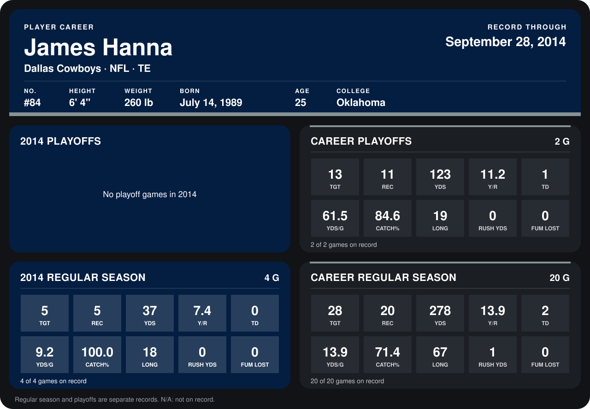

# James Hanna

## Career stats

### Regular season

| Season | Club | G | TGT | REC | YDS | Y/R | TD | YDS/G | CATCH% | LONG | RUSH YDS | FUM LOST |
|---|---|---:|---:|---:|---:|---:|---:|---:|---:|---:|---:|---:|
| 2013 | Dallas Cowboys | 16 | 23 | 15 | 241 | 16.1 | 2 | 15.1 | 65.2 | 67 | 1 | 0 |
| 2014 | Dallas Cowboys | 5 | 6 | 5 | 37 | 7.4 | 0 | 7.4 | 83.3 | 18 | 0 | 0 |
| **Career** |  | 21 | 29 | 20 | 278 | 13.9 | 2 | 13.2 | 69.0 | 67 | 1 | 0 |

### Playoffs

| Season | Club | G | TGT | REC | YDS | Y/R | TD | YDS/G | CATCH% | LONG | RUSH YDS | FUM LOST |
|---|---|---:|---:|---:|---:|---:|---:|---:|---:|---:|---:|---:|
| 2013 | Dallas Cowboys | 2 | 13 | 11 | 123 | 11.2 | 1 | 61.5 | 84.6 | 19 | 0 | 0 |
| **Career** |  | 2 | 13 | 11 | 123 | 11.2 | 1 | 61.5 | 84.6 | 19 | 0 | 0 |

## Awards

None on record.

Records through October 5, 2014. Identity: listed 2014 roster data, Weeks 1-4; number: 2014 Week 1 roster. [All Dallas Cowboys players](README.md).
