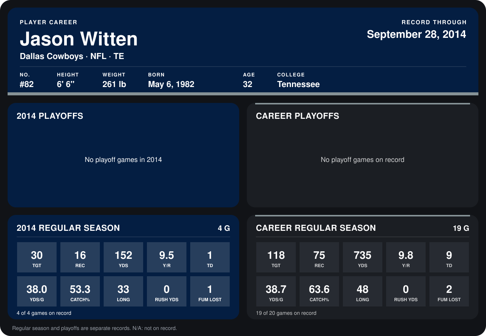

# Jason Witten

## Career stats

### Regular season

| Season | Club | G | TGT | REC | YDS | Y/R | TD | YDS/G | CATCH% | LONG | RUSH YDS | FUM LOST |
|---|---|---:|---:|---:|---:|---:|---:|---:|---:|---:|---:|---:|
| 2013 | Dallas Cowboys | 15 | 88 | 59 | 583 | 9.9 | 8 | 38.9 | 67.0 | 48 | 0 | 1 |
| 2014 | Dallas Cowboys | 5 | 32 | 17 | 165 | 9.7 | 1 | 33.0 | 53.1 | 33 | 0 | 1 |
| **Career** |  | 20 | 120 | 76 | 748 | 9.8 | 9 | 37.4 | 63.3 | 48 | 0 | 2 |

### Playoffs

No playoff games on record.

## Awards

- Pro Bowl selection (2013, TE)

Records through October 5, 2014. Identity: listed 2014 roster data, Weeks 1-4; number: 2014 Week 1 roster. [All Dallas Cowboys players](README.md).
