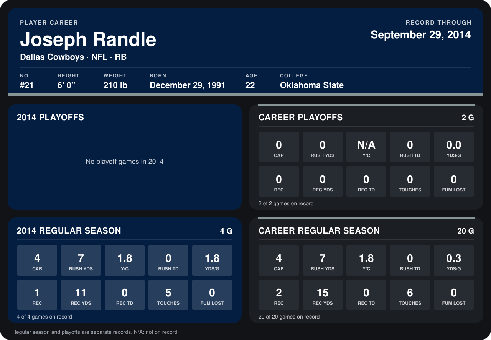

# Joseph Randle

## Career stats

### Regular season

| Season | Club | G | CAR | RUSH YDS | Y/C | RUSH TD | YDS/G | REC | REC YDS | REC TD | TOUCHES | FUM LOST |
|---|---|---:|---:|---:|---:|---:|---:|---:|---:|---:|---:|---:|
| 2013 | Dallas Cowboys | 16 | 0 | 0 | N/A | 0 | 0.0 | 1 | 4 | 0 | 1 | 0 |
| 2014 | Dallas Cowboys | 5 | 5 | 7 | 1.4 | 0 | 1.4 | 1 | 11 | 0 | 6 | 0 |
| **Career** |  | 21 | 5 | 7 | 1.4 | 0 | 0.3 | 2 | 15 | 0 | 7 | 0 |

### Playoffs

| Season | Club | G | CAR | RUSH YDS | Y/C | RUSH TD | YDS/G | REC | REC YDS | REC TD | TOUCHES | FUM LOST |
|---|---|---:|---:|---:|---:|---:|---:|---:|---:|---:|---:|---:|
| 2013 | Dallas Cowboys | 2 | 0 | 0 | N/A | 0 | 0.0 | 0 | 0 | 0 | 0 | 0 |
| **Career** |  | 2 | 0 | 0 | N/A | 0 | 0.0 | 0 | 0 | 0 | 0 | 0 |

## Awards

None on record.

Records through October 5, 2014. Identity: listed 2014 roster data, Weeks 1-4; number: 2014 Week 1 roster. [All Dallas Cowboys players](README.md).
