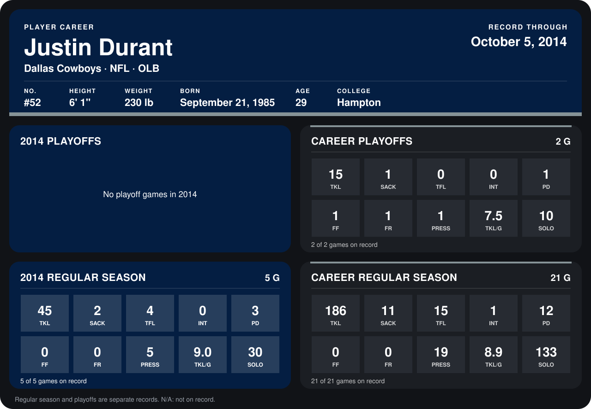

# Justin Durant

## Career stats

### Regular season

| Season | Team | Age | # | G | TKL | SACK | TFL | INT | PD | FF | FR | PRESS | TKL/G | SOLO |
|---|---|---:|---:|---:|---:|---:|---:|---:|---:|---:|---:|---:|---:|---:|
| 2013 | Dallas Cowboys | 27 | 52 | 16 | 141 | 9 | 11 | 1 | 9 | 0 | 0 | 14 | 8.8 | 103 |
| 2014 | Dallas Cowboys | 28 | 52 | 5 | 45 | 2 | 4 | 0 | 3 | 0 | 0 | 5 | 9.0 | 30 |
| **Career** |  |  |  | 21 | 186 | 11 | 15 | 1 | 12 | 0 | 0 | 19 | 8.9 | 133 |

### Playoffs

| Season | Team | Age | # | G | TKL | SACK | TFL | INT | PD | FF | FR | PRESS | TKL/G | SOLO |
|---|---|---:|---:|---:|---:|---:|---:|---:|---:|---:|---:|---:|---:|---:|
| 2013 | Dallas Cowboys | 27 | 52 | 2 | 15 | 1 | 0 | 0 | 1 | 1 | 1 | 1 | 7.5 | 10 |
| **Career** |  |  |  | 2 | 15 | 1 | 0 | 0 | 1 | 1 | 1 | 1 | 7.5 | 10 |

## Awards

- NFC Defensive Player of the Week (2013, Week 13)
- AP Second-Team All-Pro (2013, OLB)
- Pro Bowl selection (2013, OLB)

Age is his age on the league's opening game of each season; # is the number listed for him that season with that team (2014: the card's rule; 2013: the 2013 season roster), N/A where no listing applies.

Records through October 5, 2014. Identity: listed 2014 roster data, Weeks 1-4; number: 2014 Week 1 roster. [All Dallas Cowboys players](README.md).
